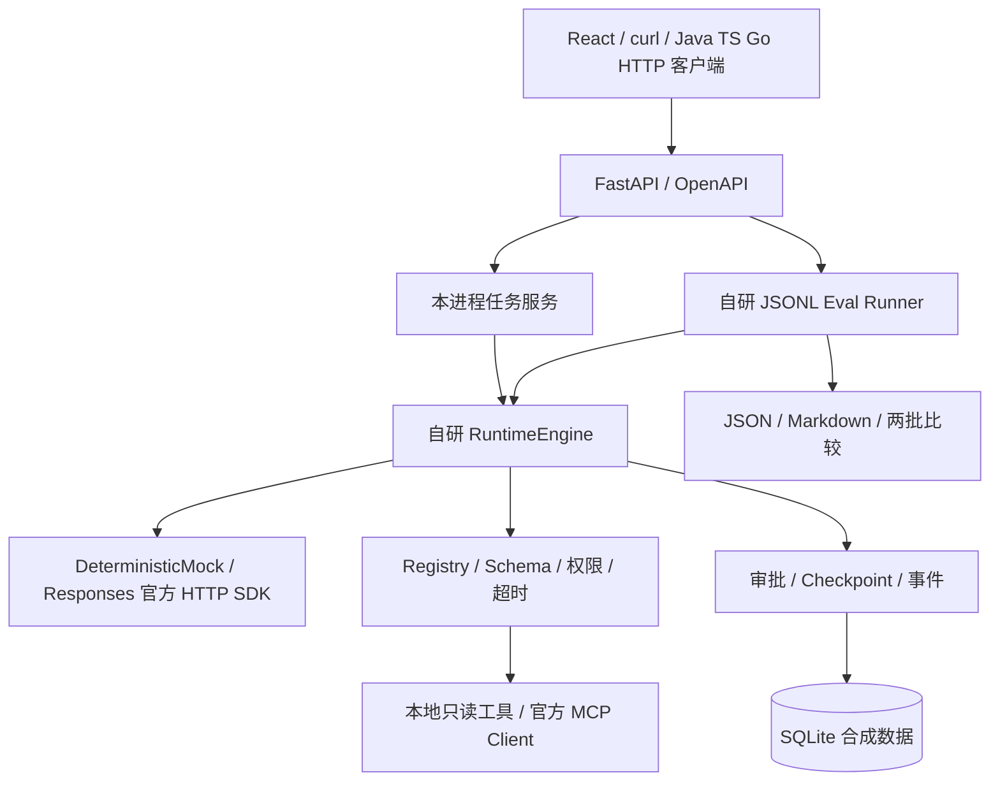
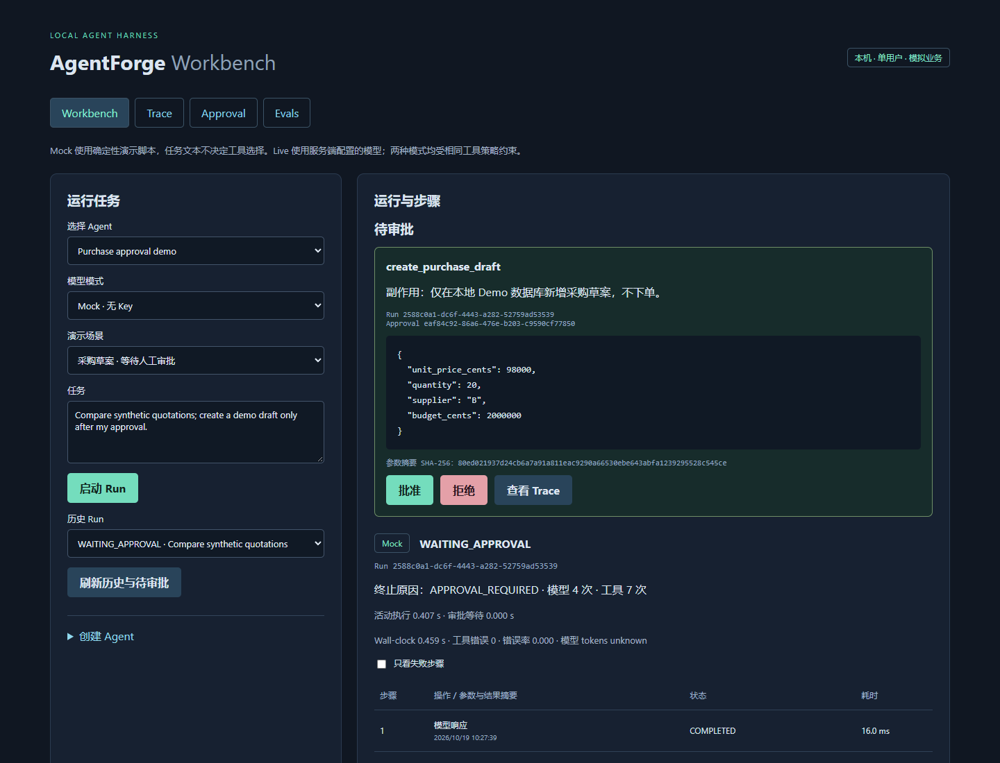
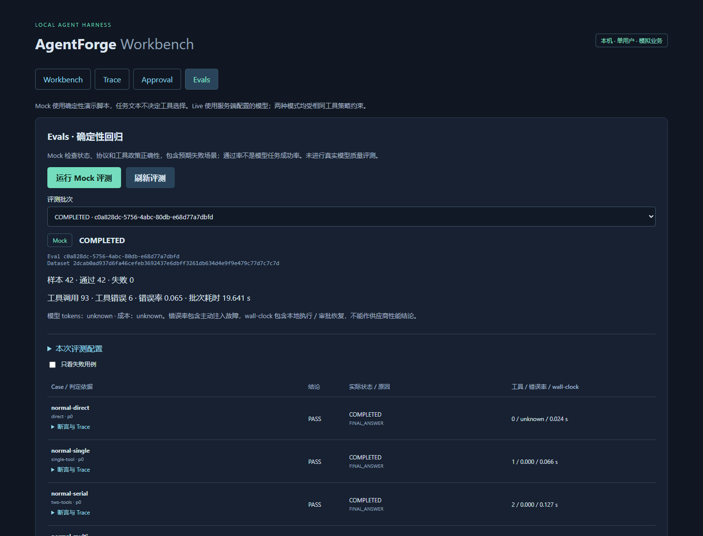

# AgentForge

面向不同语言 Agent 应用开发者的本机单用户 Agent Harness 求职作品。
本周选择 Python 实现服务端，通过 REST/JSON/OpenAPI 提供语言无关接入，前端采用 React/TypeScript。
**当前交付：Day 4 独立 JSONL 评测、安全回归、四个工作页面与 CI 配置。**
自研 Runtime 继续作为控制核心，不使用框架 Runner。实际验收状态见 [FEATURE_MATRIX](docs/FEATURE_MATRIX.md)。

## 问题定义与架构

模型会提出不确定的工具请求；AgentForge 负责将它们约束在允许列表、严格参数、次数／超时预算和人工审批之内，并保存可追溯结果。采购只是一份隔离的合成 Demo，不连接真实 ERP 或下单。



这是源码结构示意。核心 Loop、状态、政策、存储和判定均由项目源码实现；SDK 只承担模型 HTTP 或 MCP 协议。

## Quickstart：API 与 Workbench

要求 Python 3.12+、Node.js 22.12+。在源码仓库根目录安装依赖：

```powershell
git clone https://github.com/jadenmong/agent-forge.git
cd agent-forge
python -m venv .venv
.\.venv\Scripts\python.exe -m pip install -e ".[test]"
npm.cmd --prefix apps/web ci
```

两个终端分别执行：

```powershell
# 终端 1：API、SQLite Runtime、自动发现固定本机 stdio MCP Server
.\.venv\Scripts\python.exe -m uvicorn agentforge.api:app --host 127.0.0.1 --port 8000
```

```powershell
# 终端 2：React/TypeScript/Vite
npm.cmd --prefix apps/web run dev
```

浏览器打开 **http://127.0.0.1:5173**，API 文档在 **http://127.0.0.1:8000/docs**，规范在 `/openapi.json`。
Linux/macOS 用 `.venv/bin/python` 和 `npm` 替换 Windows 路径/命令。
首次依赖安装需要包仓库或缓存；安装后的 Mock/MCP 演示只访问本机。不要同时启动多个 API worker。

### 四个页面

| 页面 | 入口 | 功能 |
|---|---|---|
| Workbench | `/#workbench` | 创建 Agent、配置限制、选择 Mock/Live、发起任务 |
| Trace | `/#trace` | 历史 Run、步骤、脱敏参数/结果、耗时、异常和事件筛选 |
| Approval | `/#approval` | 具体待审调用/副作用、批准/拒绝、所选 Run 决议审计 |
| Evals | `/#evals` | 运行固定 Mock 回归集、查看逐项断言/指标、比较两个批次 |

Workbench 保留当前任务的紧凑 Trace 和待审入口；独立页面用于集中查看。页面均使用公开 HTTP API，权限由后端执行。

### 独立评测：42 条 JSONL，无 Key

数据集在 [examples/evals/mock.jsonl](examples/evals/mock.jsonl)。每条有来源、场景、固定期望状态/工具/禁止工具/草案数量、标签和受支持的判定版本，不执行任意判定代码。

```powershell
.\.venv\Scripts\python.exe -m agentforge.evals run --output data/eval-a
.\.venv\Scripts\python.exe -m agentforge.evals run --output data/eval-b
.\.venv\Scripts\python.exe -m agentforge.evals compare data/eval-a/report.json data/eval-b/report.json --output data/comparison.json
```

每次输出 report.json 和 report.md；含实际 Run ID、步骤/事件、SQL 草案计数、逐项断言、工具调用/错误率和 wall-clock。任一用例未满足固定期望时，runner 退出 1；不能通过删除、跳过失败项得到通过。两批比较只接受同模式、数据集、fixture 和判定版本；有回归时 compare 退出 1。
合成超时、供应商错误、恶意工具结果是明确的 Mock 故障注入；预期拒绝/失败可以是回归 PASS。retryable 只是错误分类，自动重试次数为 0。

**Mock 回归通过率不是真实模型任务成功率。未进行真实模型质量评测。** 模型 tokens 仅在 Live 所有模型尝试都有实际 usage 时汇总，否则 unknown；Mock 的字节预算估算或合成 usage 不记录成真实模型 tokens。价格未配置时成本 unknown，不假设 $0。
评测批次也记录运行配置、源码/fixture/数据集摘要；错误率包含主动注入的故障，耗时不是供应商延迟基准。API 启动评测使用隔离数据库，普通 Run 历史不会混入评测草案；报告中的 Run 可在该用例的 Trace 中查看。

### 截图与演示脚本

以下来自真实运行的页面，不是界面示意图：




[审批截图](docs/evidence/day4/approval.png) · [Trace 截图](docs/evidence/day4/trace.png) · [两批比较](docs/evidence/day4/comparison.png)。
完整无 Key 演示脚本：`.\.venv\Scripts\python.exe scripts/verify_day4.py`，自动分配临时端口/数据库，运行四页 Playwright、SQL、curl、两次评测和比较。需要浏览器：Windows 优先用已安装 Edge；Linux/macOS 先运行 `.venv/bin/python -m playwright install chromium`。

### Docker Compose（配置已提供，容器未测）

```powershell
docker compose up --build
```

端口为 Web 5173、API 8000，均绑定本机；命名数据卷保存 SQLite/评测，容器内单 worker。当前执行环境未安装 Docker，未实际执行容器启动，不将配置存在标为 Compose 验收通过；上面的两条开发命令是已验证路径。

### Mock 与 Live

Mock 默认无 Key，选择 Agent 和演示场景后启动；任务文本不会决定固定脚本的工具选择。
`procurement-demo` 默认执行两个串行本地工具；选择 `mcp-demo` 会执行两个真实 MCP 只读工具。界面显示 Mock 标签、状态、步骤和安全错误码。
可创建 Agent，设置名称、提示词、工具 allowlist、步数/调用次数、超时和预算；UI 使用同一公开 API。

Live 使用官方 OpenAI SDK Responses HTTP 接口。在启动 API 前，在对应终端设置：

```powershell
$env:OPENAI_API_KEY = "<your-key>"
$env:OPENAI_MODEL = "<model-id-available-to-your-account>"
```

应用不自动读取 `.env`；`.env.example` 仅说明变量。真实模型名和 API Key 从服务端环境读取，前端不接收或保存 Key。
这里指开发启动命令；Compose 的变量插值可读取本机 `.env`，真实凭据仍不应进入提交或镜像。
任一变量缺失时，Live 创建 Run 返回 `503 / LIVE_NOT_CONFIGURED`，不退回 Mock。本次环境未配置两项变量，**Live 外部 API 未测**；离线 HTTP fixture 测试不是 Live 成果。

Responses 使用 `store=false`，按顺序重放 function_call、关联 call_id 的 function_call_output 和 reasoning 的不透明 encrypted_content；不依赖 previous_response_id，不保存/展示隐藏推理原文。
续传状态保存在 SQLite 私有 `model_resume_state` 中，审批安全点可重建适配器；恢复 Live 必须配置同一模型，不能把离线续传测试当成外部 Live 实测。`store=false` 不代表自动获得账户层 Zero Data Retention；实际数据保留政策以提供商和账户配置为准。
关闭供应商自动重试；429、鉴权、网络、超时和未完成响应转为明确失败原因。单次请求设置 2048 输出 token 上限，Runtime 继续检查整体预算；成本缺价格时为 unknown。

### 非 Python 客户端：curl 创建与查询

成功响应为 `{data, request_id}`，错误为 `{error: {code, message, request_id}}`。
在 PowerShell 中通过真实 curl 与原生 JSON 解析完成，无需 Python 客户端 SDK：

```powershell
$created = curl.exe --silent --show-error --fail --noproxy "*" -X POST -H "Content-Type: application/json" --data-binary "@examples/http/create-run.json" http://127.0.0.1:8000/api/runs | ConvertFrom-Json
$runId = $created.data.run_id
curl.exe --silent --show-error --fail --noproxy "*" "http://127.0.0.1:8000/api/runs/$runId"
curl.exe --silent --show-error --fail --noproxy "*" "http://127.0.0.1:8000/api/runs/$runId/steps"
```

创建返回 HTTP 202，状态不保证同步完成，客户端轮询查询。Java/Go/TypeScript 同样可发送 HTTP/JSON 请求，不代表已经提供原生 Runtime 或官方 SDK。
端点、错误码、游标与重复提交语义见 [API_CONTRACT](docs/API_CONTRACT.md)。

同样可用任意 HTTP 客户端发起 Mock 评测，创建返回 202，随后查询状态：

```powershell
$batch = curl.exe --silent --show-error --fail --noproxy "*" -H "Content-Type: application/json" --data-binary "@examples/http/create-eval.json" http://127.0.0.1:8000/api/evals/run | ConvertFrom-Json
$evalId = $batch.data.eval_id
curl.exe --silent --noproxy "*" "http://127.0.0.1:8000/api/evals/$evalId"
```

HTTP/API 不接受任意数据集路径、命令或 Key；服务端仅运行仓库固定套件。不同语言能调用 REST API，不等于实现了多语言 Runtime 或官方 SDK。

### MCP 与进程限制

固定 `mcp==2.3.0`、协议 `2026-07-28`，使用 `MCPServer` / `Client`，默认通过 server/discover 探测，不手动执行旧 initialize。
只连接源码固定的本机 `python -m agentforge.mcp_server`，不接受 URL、安装命令或任意远端 Server。
同一 Registry 暴露六个工具：三个 local、两个带 mcp_ 前缀的只读 MCP 工具，以及必须审批的 `create_purchase_draft`。权限由后端决定，服务端注解和 prompt 不构成授权。
发现与每次调用各自管理一个 stdio 子进程；统一检查 JSON Schema、权限、超时、结果大小。没有外部 MCP 自动重试。

Agent、Run、Step、Event、ToolInvocation、Approval、模型续传状态与模拟草案持久化到 SQLite。后台执行任务仍由当前 asyncio 进程持有，正常关闭时取消；等待审批的 Run 已释放活动执行槽位。仅启动一个 API worker，无分布式队列。
本机最多四个活动执行任务、二百条持久化 Run 和一百个 Agent，容量满返回 409；没有自动清理、分页归档、多租户或 OAuth。

### Day 3：无 Key 的审批与重启演示

选择 `purchase-demo`，场景为“采购草案 · 等待人工审批”，输入演示任务并启动。查看待审供应商、数量、整数分单价、预算和参数摘要；此时数据库没有草案。停止并重新启动 API，刷新浏览器，仍能看到同一 Run 和 approval_id。批准后新增一份本地模拟草案并继续模型；拒绝后取消且无草案。完整成功脚本为 5 次模型、8 次工具调用，包含 7 次只读调用和 1 次批准写入，不代表真实模型能力。

默认文件是仓库 `data/demo.db`，启动时自动创建目录和 schema v1；可在 API 进程设置 `$env:AGENTFORGE_DB_PATH = "F:/temp/agentforge-demo.db"` 使用独立文件。SQLAlchemy 固定 2.0.55，SQLite 开启 WAL、外键和 5 秒 busy timeout。初始化仅支持空库到 v1，未知版本拒绝启动，不删除已有数据；没有通用升级迁移器。

HTTP 审批同样无需 Python 客户端：

```powershell
$created = curl.exe --silent --show-error --fail --noproxy "*" -H "Content-Type: application/json" --data-binary "@examples/http/approval-run.json" http://127.0.0.1:8000/api/runs | ConvertFrom-Json
$runId = $created.data.run_id
# 等状态为 WAITING_APPROVAL 再查询；异步创建不保证已就绪。
curl.exe --silent --noproxy "*" "http://127.0.0.1:8000/api/runs/$runId"
$pending = curl.exe --silent --noproxy "*" "http://127.0.0.1:8000/api/runs/$runId/approvals" | ConvertFrom-Json
@{approval_id=$pending.data[0].approval_id; decision="approve"} | ConvertTo-Json -Compress | Set-Content -Encoding ascii approval-request.json
curl.exe --silent --show-error --fail --noproxy "*" -H "Content-Type: application/json" --data-binary "@approval-request.json" "http://127.0.0.1:8000/api/runs/$runId/approve"
curl.exe --silent --noproxy "*" "http://127.0.0.1:8000/api/runs/$runId"
```

审批只接受 ID 和决议，不接受替换参数。相同决议重复提交返回 `replayed=true`；相反决议返回 409。不同 Run 的新审批仍会创建自己的草案，请求级 Run 创建没有幂等。

**能恢复 / 不能恢复：**

- `WAITING_APPROVAL`：校验配置、续传上下文、调用及参数摘要后保留同一待审调用；批准才执行。
- 已提交本地草案且 checkpoint 为 `AFTER_APPROVED_TOOL`：启动后为 `INTERRUPTED`，仅凭据和上下文校验通过才允许 `POST /api/runs/{id}/resume`；不会重做写入。
- 进行中的模型/只读调用：标记 `INTERRUPTED`，当前不支持继续；结果未知的写调用进入 `RECONCILIATION_REQUIRED`，不盲目补发。终态不恢复。
- 同一 SQLite 事务提交审批、草案、工具结果和安全 checkpoint；这仅证明本地模拟写入的幂等，不保证任意外部副作用 exactly-once。

Trace 轮询展示历史、步骤、参数/结果摘要、耗时、异常与 checkpoint/审批事件。公开输出做已知字段脱敏；精确任务上下文及不透明加密续传内容留在私有数据库，不由 API 返回。数据库不是加密保险箱，请只使用合成 Demo 数据；没有通用 DLP 或任意代码隔离。

### 当前完整验证

```powershell
.\.venv\Scripts\python.exe -m pytest -q
npm.cmd --prefix apps/web run build
.\.venv\Scripts\python.exe scripts/verify_day4.py
```

Day 4 统一脚本自动分配本机临时端口和数据库，运行格式检查、全量 pytest、两次独立 Mock eval、比较、前端构建、四页浏览器与 curl。pytest 仍覆盖 Day 3 的真实 API 重启；评测中的恢复案例还使用两个独立 Runtime worker 进程。仅清理自己启动的进程和临时文件。默认开发端口仍是 8000/5173。Vite 改 API 端口时可设置 `AGENTFORGE_API_PORT`。
Windows 优先使用已安装的 Edge；其他环境先执行 `.venv/bin/python -m playwright install chromium`。首次依赖/浏览器安装需要网络，安装后的 Mock、MCP、HTTP 和浏览器验证只访问本机。
当前证据写入 `docs/evidence/day4/`，原 Day 1–3 证据保留；[Day 4 交付报告](docs/deliveries/2026-10-19-day4.md)列出实际测试、文件、API 与验收。
CI 配置在 [.github/workflows/ci.yml](.github/workflows/ci.yml)：格式、pytest、独立 Mock eval、前端构建和 Playwright 任一失败即 fail，不在 PR CI 中配置或调用付费 Live API。云端 Actions 是否运行以真实记录为准，本次没有推送触发云端 CI。

## Day 1 CLI（保留，无需模型 Key）

```powershell
python -m venv .venv
.\.venv\Scripts\python.exe -m pip install -e ".[test]"
.\.venv\Scripts\python.exe -m ruff check src tests scripts
.\.venv\Scripts\python.exe -m ruff format --check src tests scripts
.\.venv\Scripts\python.exe -m agentforge.demo
.\.venv\Scripts\python.exe -m pytest -q
```

重跑格式检查、pytest 和 9 个 CLI 检查并保存原始证据：

```powershell
.\.venv\Scripts\python.exe scripts/verify_day1.py
```

Day 1 补齐时记录：70 项 pytest 通过、0 失败；9 个 CLI 检查符合预期，证据在 `docs/evidence/day1-completion/`。当前完整测试结果以 [RESULTS](docs/RESULTS.md) 最新记录为准；原始 10/14 证据保留。

Linux/macOS 使用 `.venv/bin/python` 替换上述虚拟环境解释器路径。
首次安装依赖需要访问包仓库或已有 wheel 缓存；安装完成后演示与测试不访问网络。

Demo 通过三个只读工具完成合成供应商报价、交期保修和总价查询：4 轮模型响应、7 次顺序工具调用，输出明确标记 `mock`。
数据来自 `examples/procurement/fixtures.json`，按严格模型校验，并检查 A/B/C 不重复。计算工具使用请求中的整数单价与数量。
需要保留源码 checkout 并按上面命令 editable 安装；尚未实现 fixture 的独立 wheel 打包。
这是固定脚本验证控制流，不是模型智能、实时供应商信息或采购建议。默认最终文本在脚本组装时根据 fixture 生成，不对工具输出进行智能判断。不会生成草案或订单。

限制终止演示（预期退出码 1、`FAILED / MAX_STEPS`）：

```powershell
.\.venv\Scripts\python.exe -m agentforge.demo --max-steps 1
```

## Mock 场景

使用 `python -m agentforge.demo --scenario <名称>`；上面的虚拟环境解释器路径同样适用。

| 场景 | 行为 / 预期终止 |
|---|---|
| `procurement`（默认） | 三个工具、4 轮模型响应，`COMPLETED / FINAL_ANSWER` |
| `direct` | 直接回复，零工具调用 |
| `single-tool` | 一次工具调用后回到模型 |
| `two-tools` | 两轮各调用一个工具，再回到模型完成 |
| `unknown-tool` | 请求未注册工具，`FAILED / UNKNOWN_TOOL` |
| `repeat` | 用新 call ID 持续请求同一只读工具，直到上限终止 |
| `tool-error` | 显式注入本地模拟工具异常，`FAILED / TOOL_ERROR` |

独立模型调用次数上限演示（预期退出码 1）：

```powershell
.\.venv\Scripts\python.exe -m agentforge.demo --scenario repeat --max-model-calls 2
```

同一 call ID 重复时立即拒绝，原因是 `DUPLICATE_CALL_ID`；新 ID 的重复行为由次数、时间和预算上限限制。
失败演示退出码 1 是预期行为，不等于测试失败。

## 已实现与边界

- 自研 `model → calls → results → model` 顺序循环，零/单/多调用，拒绝重复 call ID。
- 使用 `AgentConfig`、`ModelAdapter`、`ToolDefinition`、`ToolCall`、`ToolResult`、`RunState`、`RunStep`、`RunEvent`；工具结果实际经由 `ToolResult` 回到模型。
- Pydantic v2 生成工具 JSON Schema，并在执行入口严格校验；allowlist 默认空。
- 只读默认；普通 Registry.dispatch 始终阻断需审批写入；持久化 Runtime 通过独立后端政策事务执行绑定的本地草案写入。
- `max_steps`、`max_model_calls`、工具次数、wall time、调用超时、token 配额、输入/输出大小限制。模型调用尝试计数包含失败请求；当前无重试，每轮只请求一次模型，两项计数通常相同。
- CLI 输出 Run ID、状态、终止原因、逐操作步骤及事件。调用方取消协程时记录 CANCELLED 和步骤状态，再传播取消异常；可通过传入的 `RunState` 查看结果。
- 事件带时间、持久化顺序游标、模式、关联 ID 与实测耗时；不保存原始任务或隐藏推理到事件，工具参数/结果只保留脱敏摘要。
- 未知 usage 使用 UTF-8 字节数估算限流，不是真实 token 统计；价格未配置，成本为 `null`（unknown）。

仅运行可信、协作式异步本地工具；超时依赖事件循环取消，不是进程隔离，不保证阻塞或忽略取消的代码能被强制终止。
没有任意代码、shell、URL 或文件访问工具。重启恢复限于上述验证过的安全断点。
CLI 最终结果是公开的合成 Demo 数据；运行上下文仅在内存存在，不适合输入真实敏感信息。

## 文档与证据

- [PRD](docs/PRD.md)：范围及验收依据（保留原文）。
- [一页实施清单](docs/IMPLEMENTATION_PLAN.md) · [架构](docs/ARCHITECTURE.md)
- [决策](docs/DECISIONS.md) · [接口契约](docs/API_CONTRACT.md)
- [实际测试结果](docs/RESULTS.md) · [P0 事实矩阵](docs/FEATURE_MATRIX.md)
- [故障案例](docs/FAILURE_MODES.md) · [面试问答](docs/INTERVIEW_NOTES.md)

Codex 负责本次代码实现；候选人参与需求、技术决策、审核、验收与面试讲解，具体参与记录由本人确认。
项目仓库：[jadenmong/agent-forge](https://github.com/jadenmong/agent-forge)。Compose 已配置但容器未测；恢复仅限明确安全点，本机 SQLite 不是生产数据库/队列，脱敏不是通用 DLP，没有 OAuth、多租户、任意代码执行或真实采购交易能力。
