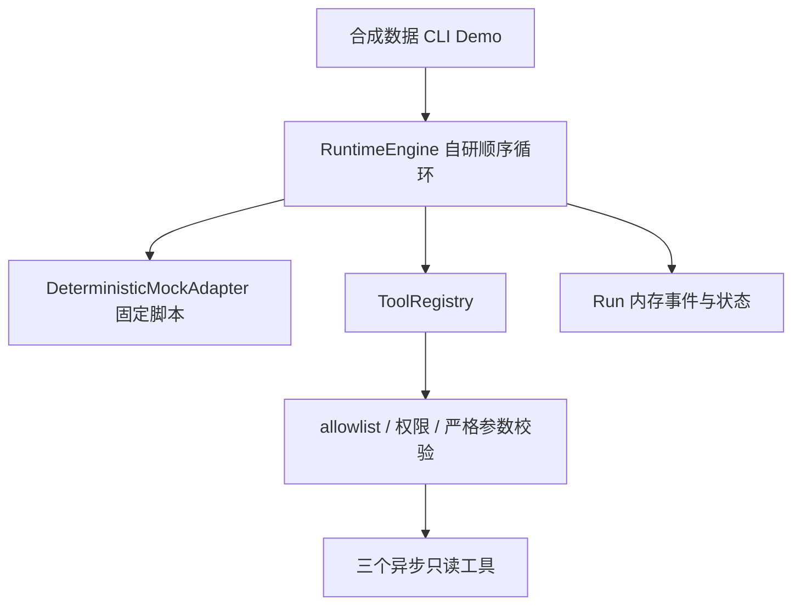

# 架构：2026-10-14 已实现范围

入口：`src/agentforge/demo.py:main` → `RuntimeEngine.run` → `adapter.respond` → 整批预检 → `registry.dispatch` → 工具结果以 `untrusted` 数据返回模型。
每个调用顺序执行；任何失败立即终止，无自动重试。整批预检只防止已知无效请求产生部分执行；运行期间后续调用失败时，不会回滚前面已完成的只读调用。

`models.py` 的中立协议只用于首日 Mock；不是 Responses API 协议，也不承诺可直接重放供应商对象。
后续 Responses 适配器须单独维护合法的 reasoning items/function_call/call_id/续传语义。

计划的 API、React、MCP、SQLite、审批和评测边界见 `IMPLEMENTATION_PLAN.md`，不属于上图已实现部分。
