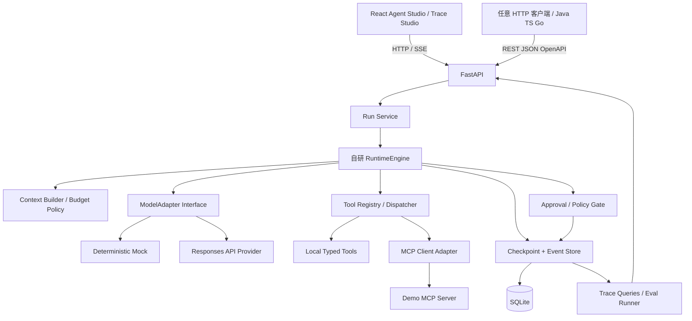
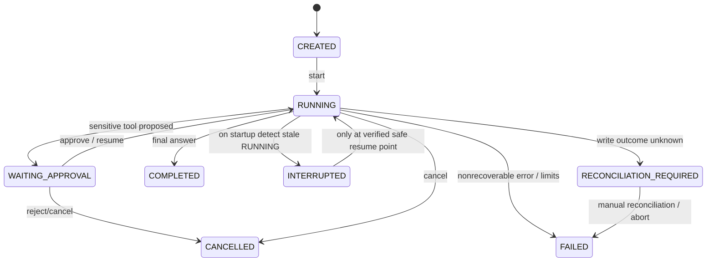

# AgentForge — 通用 AI Agent Runtime 与可视化调试平台

## 产品需求与技术架构

> 基准日期：2026-10-14；本周截止：2026-10-18 23:00（UTC+8）；2026-10-19 起开始投递。  
> 产品定位：**面向不同编程语言开发者**的轻量 Agent Runtime、执行调试和评测平台；本周交付本机单用户 MVP，不是生产 SaaS。  
> 实现定位：**Python 是本周 Runtime 实现语言，而非平台用户的语言限制**；Web/HTTP/OpenAPI/MCP 是跨语言互操作边界。  
> 项目角色：Codex 执行全部编码；候选人负责理解需求、确认技术取舍、验收、代码审阅、测评证据和面试解释。  
> 文档状态：这是**开发规格与计划**，不是功能已经交付的声明。

## 0. 项目目标与简历证据原则

核心目标：把“不确定的 LLM 决策”纳入可控运行时：**可执行、可观察、可中断、可恢复、可评估、有限预算、受权限约束**。

**一句话产品说明：**AgentForge 为 Python、Java、TypeScript、Go 等技术栈的 Agent 应用开发者提供一套可通过标准 HTTP API 调用的轻量 Agent 执行环境，以及独立于应用语言的运行观察、审批和评测界面。本周只实现 Python 服务端，不提供 Java/Go 等语言版本的 Runtime。

**简历项目定位：**证明 Agent Runtime / LLM 应用工程能力，而不是宣称已开发成熟的跨语言 Agent 平台或已取得生产业务效果。

最终可交付：
- GitHub 公共仓库（不可含密钥/真实客户数据）；本地 `docker compose up --build` 可运行。
- 有 Mock 模型模式（无需密钥、确定性可重复）与至少一种可选真实 LLM API 模式。
- 端到端 Demo，展示任务 -> 工具决策 -> 审批 -> 恢复 -> 结果与完整 Trace。
- 30–50 条不同用途的评测/故障用例，其中硬性回归案例必须全部执行；输出可追溯指标。
- 架构图、运行文档、测试报告、设计取舍、失败案例、面试讲解材料。

**不得声称**“企业级多租户”“生产环境规模”“恰好一次工具执行”“安全地执行任意代码”“测试准确率 95%”等尚未实现或未量化的结论。

## 1. 产品边界

### 1.1 用户画像与 JTBD

目标用户：**AI Agent 应用开发者、后端工程师、Agent 平台工程师和评测/调试人员**，不依赖其常用语言是 Python、Java、TypeScript 还是 Go；另有面试官作为作品评审者。

核心任务（JTBD）：
1. 从网页或任意可发 HTTP 请求的客户端配置/启动一个 Agent Run。
2. 查看模型如何请求工具、运行时如何校验与执行、运行状态如何转换，以及失败发生在哪一步。
3. 对具有副作用的操作进行人工确认，随后能够从**定义好的安全断点**恢复。
4. 在同一份固定数据集上回归测试和比较两个版本，不混淆 Mock 程序正确性与 Live 模型任务质量。

**语言无关的精确定义：**本周提供标准 REST/JSON（含 OpenAPI 规范）和可互操作的 MCP 工具接口；不同语言的开发者可以调用平台 API。并不承诺可以把任意语言的函数直接加载到 Python Runtime、提供多语言官方 SDK、运行跨语言插件或执行任意用户代码。

### 1.2 必须完成（P0）

1. **Agent Studio**：配置 Agent 名称、系统提示词、模型（Mock/真实模型）、可用工具、最大步数、调用超时和预算；网页操作与 REST API 功能一致。
2. **Execution Engine**：实现不依赖 LangGraph/Agents SDK 的完整 `model -> tool calls -> tool results -> model` 循环；支持零、一个、多个调用请求，执行顺序确定，有限次数和清晰结束原因。
3. **Tool Registry**：注册 JSON Schema、参数校验、权限（只读/需审批/禁用）、超时、错误结构；至少 3 个本地工具。
4. **MCP Adapter**：至少接入一个使用官方 MCP Python SDK 的 MCP Server，展示发现工具和调用工具；注明支持的 SDK/协议版本及 transport。
5. **Checkpoint/Recovery**：持久化 Run、Step、Event、审批等待状态和模型续传所需上下文；页面刷新/进程重启可查看并恢复一个明确的等待点。
6. **Human Approval**：一项有业务副作用的“创建采购草案”模拟工具，需要显式批准；拒绝则不执行；审批请求有唯一 ID 和审计记录。
7. **Trace Studio**：显示任务列表、状态、步骤 Timeline、输入输出摘要、工具参数/结果、时延、token/成本（有数据才展示，缺失时标记 unknown）。
8. **Evals**：Mock 确定性回归 + 可选真实模型质量评测；支持 JSONL 数据集、指标计算、两次 run 比较，不能混淆两套结果。
9. **安全护栏**：tool allowlist、只读默认、审批前不执行写操作；敏感字段不进日志；工具内容视作不可信数据；预算上限和循环熔断。
10. **跨语言可用的 API 与文档**：FastAPI 自动生成 OpenAPI、规范的 REST/JSON 请求/响应和错误码，提供一条独立于 Python SDK 的 `curl` 运行示例；可复现启动脚本、`.env.example`、README、架构图、测试命令。

### 1.3 可做则做（P1，放在 P0 之后）

- SSE 运行事件流（如果实时订阅难度大，至少轮询显示状态；优先 SSE）。
- SQLite FTS5 文档检索工具，演示基础检索与引用，不把它冒充向量/混合 RAG。
- 真实 LLM 的流式 token 文本输出（仅当主循环和 Checkpoint 可靠后）。
- LangGraph 10–20 行独立对照 Demo（不能替代自研核心）。
- 导出 Run 的可共享 JSON、局部上下文裁剪和提示词版本化。
- 从 OpenAPI 生成的 TypeScript/Java 客户端使用示例（只作为外部 API 接入示例，不声称实现非 Python Runtime）。

### 1.4 本周明确不做（P2）

多租户与 OAuth、分布式调度、多 Agent 自动协同、生产级工作节点集群、Web Browser/任意 shell 执行、通用远程 MCP 市场、向量数据库集群、在线计费、真实采购订单写入、长期跨用户记忆、真实生产 HA/SLA、Java/Go/Node 原生 Runtime、多语言插件沙箱以及任意第三方语言代码的执行。

### 1.5 产品与技术边界核对表（防止再次混淆）

| 维度 | 本周明确交付 | 不能声称 |
|---|---|---|
| 产品受众 | 各语言技术栈的 Agent 应用开发者 | 仅供 Python 工程师使用 |
| 服务端实现 | Python 3.12+ 自研 Agent Runtime | 多语言 Runtime 已实现 |
| 外部客户端 | 任意可以发送 HTTP/JSON 请求的程序；Web 控制台 | 已提供 Java、Go、Node 的官方 SDK |
| 工具互操作 | MCP SDK 2.x 的本机示例，和本地 Python Tool Registry | 可执行任意语言插件、任意远程 MCP 均安全 |
| Demo 业务 | 沙箱采购案例，用于验证 Runtime 工作机制 | 产品只适用于采购、具备真实订单能力 |
| 状态恢复 | 特定安全断点的暂停和恢复 | 任意位置无损恢复、跨系统 exactly-once |
| 测试结论 | Mock 逻辑测试 + 可选 Live 测评 | Mock 全绿代表真实模型准确率 |

## 2. 一条完整的演示任务

**示范 Agent：采购报价分析助手（Sandbox-only）**。它是供平台验证的一个 **Agent 预设/样例**，不是 AgentForge 被限定为采购行业产品。

输入任务：
> “比较供应商 A/B/C 的 20 台显示器采购报价，预算上限 20000 元；结合交期与保修做出选择，先生成采购草案，然后暂停等待我批准，不要直接下单。”

本地模拟数据包括：供应商报价、库存/交期、保修条款、规则说明。可用工具：
- `list_supplier_quotes`（只读）
- `get_supplier_detail`（只读）
- `calculate_total_cost`（只读、确定性计算）
- `search_procurement_policy`（只读，P1 FTS5）
- `create_purchase_draft`（写入模拟 SQLite 表，必须审批；幂等键）

期望执行：
1. Agent 调只读工具获取事实并计算；
2. 对比选项、陈述假设/不确定性；
3. 生成 `create_purchase_draft` 的待执行调用，状态切到 `WAITING_APPROVAL`；
4. 用户 **Approve** 后真正调用工具并记录结果；**Reject** 后明确标注取消；
5. 再请求模型综合工具输出，最终 `COMPLETED` 或清晰 `FAILED`；
6. 可在等待批准时重启服务，恢复同一个待审批任务；
7. 重复审批、重放 run、工具超时/异常均有确定性测试。

原则：所有供应商、订单均是模拟数据；Run 结果不等于采购建议的真实性。至少提供 2 个额外运行案例：预算不足（不可通过）和工具超时（可定位错误）。

## 3. 技术栈与理由

| 层 | 选型 | 为什么 / 本周约束 |
|---|---|---|
| Runtime 实现语言 | Python 3.12+ | 仅为 5 天 MVP 的工程实现选型，不限制平台用户的开发语言 |
| 外部协议/API | FastAPI + Pydantic v2 + REST/JSON/OpenAPI | 接入端语言无关；可用 curl、Java、TS、Go 等任意 HTTP 客户端 |
| Agent Runtime | 自研 `RuntimeEngine` | 可以真正证明 Loop、调度、状态、限制器能力 |
| 模型适配 | `MockModelAdapter` + `OpenAIResponsesAdapter` | Mock 离线稳定验收；真实 API 验证兼容性 |
| MCP | 官方 `mcp` Python SDK v2（锁定确切版本） | 2026-07-28 规范；用 SDK 而不是自己重新造 MCP 协议 |
| 存储 | SQLite + SQLAlchemy（WAL，本地单实例） | 5 天内快速交付和本地重启恢复，不宣称多节点一致性 |
| 前端 | React + TypeScript + Vite | Timeline/审批/Agent 控制台交互足够 |
| 测试 | pytest、pytest-asyncio、HTTPX、Playwright（关键路径） | 确定性回归与端到端验证 |
| 事件链路 | SSE 优先、轮询兜底 | UI 看到执行中事件；断线后以数据库真相补读 |
| 部署 | Docker Compose | 可复现运行 |

**框架边界：** 不要通过导入 Agents SDK 或 LangGraph 来间接执行核心 Runner；可以在 `examples/` 中单独做框架对比。模型调用使用官方 SDK/HTTP 客户端，循环控制在自研层。自研的是**运行时控制逻辑**，不是 HTTP 协议、MCP 协议或底层模型推理。

**为何这次不改为多语言 Runtime：** 本周的成果优先证明自研 Agent Loop、执行与权限、恢复和评测；Python 的生态与交付速度有利于达成时限。若以后另做 Java/TypeScript Runtime，需要单独实现执行器或定义跨进程 worker 协议，并做兼容与安全测试，不能只靠 REST API 自动获得。

**模型适配注意：** Responses API 的 reasoning items 与 `function_call`/`function_call_output`/`call_id` 是独立协议对象；Codex 必须按官方要求保留 continuation 需要的内容，不能简单把所有东西拍平成 `{role,content}`。不要保存/展示隐藏推理原文。`previous_response_id` 如涉及提供商保留数据，需在 README 说明 `store` 语义、连续性要求和使用局限。为简化恢复，建议实现应用自己的可序列化协议事件层，并让适配器负责合法重放，而不是自造 provider 私有对象。

## 4. 高层架构



### 4.1 模块目录（建议，不强制命名）

```
agentforge/
  apps/web/                    # React UI
  services/api/                # FastAPI, routes, request validation
  packages/runtime/            # 自研 Loop、状态机、预算、事件
  packages/models/             # ModelAdapter / Mock / Responses
  packages/tools/              # registry、policy、local tools
  packages/mcp_adapter/        # MCP official SDK client + demo server
  packages/storage/            # ORM、checkpoint、event log、idempotency
  packages/evals/              # jsonl、runner、metrics、compare
  examples/procurement/        # 数据、Agent preset、示例任务
  tests/unit/
  tests/integration/
  tests/e2e/
  docs/ARCHITECTURE.md
  docs/API_CONTRACT.md            # REST/JSON + OpenAPI + curl 语言无关示例
  docs/DECISIONS.md
  docs/INTERVIEW_NOTES.md
  docs/FAILURE_MODES.md
  docs/RESULTS.md
  scripts/
  docker-compose.yml
  .env.example
  README.md
```

## 5. 关键状态与数据契约

### 5.1 运行状态机



状态名及边缘处理须写在 `docs/DECISIONS.md`：超时、超预算、重复操作、恢复时未完成的工具调用如何处理。**不要承诺任意中断点无损恢复**：本周首要保证 `WAITING_APPROVAL` 的安全恢复；对于上一次正在执行但状态未知的外部写操作，进入 `RECONCILIATION_REQUIRED`，不得自动补发。无写入风险的中断任务也只能从已验证的一致性边界恢复。

### 5.2 推荐核心实体

- `AgentConfig`: `id`, `name`, `system_prompt`, `model_adapter`, `model_name`, `allowed_tools`, `limits`, `version`。
- `Run`: `id`, `agent_id`, `input`, `status`, `step_count`, `started_at`, `finished_at`, `stop_reason`, `model_resume_state`, `error`。
- `RunStep`: `run_id`, `seq`, `kind`（model/tool/approval/checkpoint）, `status`, `started_at`, `duration_ms`, `summary`。
- `ToolInvocation`: `call_id`, `run_id`, `tool_name`, `validated_args`, `status`, `result`, `idempotency_key`, `approval_id`。
- `Approval`: `approval_id`, `run_id`, `call_id`, `tool_name`, `request_payload`, `status`, `decided_at`。
- `RunEvent`: `event_id` (自增/可恢复游标), `run_id`, `timestamp`, `type`, `payload_redacted`。
- `EvalCase`/`EvalResult`: `case_id`, `expected`, `actual`, `passed`, `metric_details`, `mode`（Mock/real）。

### 5.3 Event 类型

`run.created`, `run.started`, `model.requested`, `model.responded`, `tool.requested`, `tool.started`, `tool.completed`, `tool.failed`, `approval.requested`, `approval.approved`, `approval.rejected`, `run.checkpointed`, `run.resumed`, `run.completed`, `run.failed`, `run.cancelled`。

每个 Event 尽可能包含 `run_id`, `step_id`, `correlation_id`, 时间戳和脱敏后的元数据；真实模型思维链不在 Trace 中出现。

### 5.4 严格不变量（必须用测试验证）

1. 同一 `Run` 的合法状态迁移受控，不出现 `COMPLETED -> RUNNING`。
2. 非法工具名/Schema 参数不会被执行。
3. 未批准的敏感工具调用绝不执行；拒绝后的调用绝不执行。
4. 同一审批决议/相同幂等键的写入重试不会产生第二份模拟采购草案。
5. 步数/时间/Token 上限必须导致明确终止，并记录原因；未知 token 用内部估算限制并明确是估计值。
6. 工具报错不会默默被当作成功；恢复后仍能查看之前的 Trace。
7. 高风险副作用工具在恢复时不得盲目重发；未知执行结果进入待核对/失败状态。只保证应用层幂等演示，**不保证通用 exactly-once**。
8. MCP/检索工具输出属于不可信数据，不得绕开系统策略直接取得额外权限。
9. 模型 API 密钥和个人信息不得进入源代码、HTTP 错误响应、Trace 原始事件或 GitHub 提交。

## 6. API 契约（建议）

| 方法 | 路径 | 作用 |
|---|---|---|
| GET/POST | `/api/agents` | Agent 列表/创建 |
| GET | `/api/agents/{id}` | Agent 配置 |
| GET | `/api/tools` | 工具能力/权限描述 |
| POST | `/api/runs` | 创建并启动 Run，返回 run_id |
| GET | `/api/runs` | 列表、状态和分页 |
| GET | `/api/runs/{id}` | Run 快照、终止原因、成本字段 |
| GET | `/api/runs/{id}/events` | 按 event_id 游标查询事件 |
| GET | `/api/runs/{id}/stream` | 可选 SSE 运行事件 |
| POST | `/api/runs/{id}/approve` | 审批 `{approval_id, decision}`，幂等 |
| POST | `/api/runs/{id}/resume` | 恢复被允许的中断任务 |
| POST | `/api/runs/{id}/cancel` | 取消 |
| POST | `/api/evals/run` | 触发评测，输出评测 run id |
| GET | `/api/evals/{id}` | 指标/用例/失败原因 |
| GET | `/health` | 健康检查 |
| GET | `/openapi.json` | 标准 OpenAPI 规范，供非 Python 客户端发现 API 契约 |

控制接口的成功/错误响应必须有统一结构、准确 HTTP 状态码、`request_id`；字段命名统一使用公开文档约定的 `snake_case`，不得让客户端依赖 Python 类名。`POST` 相关接口需明确幂等与并发冲突处理。

**示例（字段是期望契约，Codex 可细化但须同步 OpenAPI）：**

```http
POST /api/runs
Content-Type: application/json

{
  "agent_id": "procurement-demo",
  "mode": "mock",
  "input": "比较 A/B/C 供应商报价并创建待审批采购草案"
}
```

```json
{
  "run_id": "<generated-uuid>",
  "status": "CREATED",
  "mode": "mock"
}
```

```json
{
  "error": {
    "code": "APPROVAL_CONFLICT",
    "message": "The approval has already been decided",
    "request_id": "<generated-id>"
  }
}
```

状态不保证同步完成，客户端以 `GET /api/runs/{id}` 查询结果；外部使用者至少能用 `curl` 实现 Run 提交、查询、审批，无需 Python 环境（服务端仍需 Python 部署）。

**接口示例验证：** 本地 `curl` 发请求并解析响应；前端必须复用同一公开 API，不允许 UI 通过私有内存状态获得额外执行权限。

## 7. 页面需求（只做能面试展示的交互）

**Page A / Workbench**：Agent preset、Mock/Live 模式选择、输入任务、一键运行、任务状态徽标、最终输出和执行限制。默认 Mock 模式。

**Page B / Run Trace**：步骤时间线（LLM 调用 / Tool / Approval / Checkpoint）、耗时、简短参数与结果、错误原因、模型/工具调用统计；可搜索/筛选失败步骤；不暴露原始内部推理。

**Page C / Approval Inbox**：清晰展示待审批工具、参数、后果；Approve / Reject；UI 禁止重复提交但真正保证在后端。

**Page D / Evals**：最近测试批次、用例通过率、按错误类别分布、Mock 和 Live 结果分开展示、可点开失败案例。

视觉风格：严肃开发者工具，无花哨首页动画；组件支持可访问性；重要操作有可见反馈。

## 8. 评测与性能契约

### 8.1 测试集

- 30–50 条 **可复现** 案例，需记录来源（人工构造/脚本生成/手工校验）。其中建议 10 条正常执行、10 条工具或协议异常、10 条审批/恢复/幂等、5–10 条越权/注入/预算限制；每条均有清晰断言。
- 必须覆盖：正常单轮、连续工具、工具多返回、无效参数、工具超时、工具错误、未知工具、重复工具请求、审批批准/拒绝、重复审批、进程重启后恢复、超过最大步数/预算、Prompt Injection、越权写入请求、MCP 连接异常。
- **Mock 回归集**：通过率要求 100%（经明确断言）；这不能作为真实 Agent 智能程度指标。
- **Live 小样本**：至少 10 条（仅有可用密钥且成本许可时），报告实际成功数/总数、失败类别、模型版本、日期、成本；无密钥则标记“未运行”。

### 8.2 指标定义

- Task success = 完成业务目标且满足约束的任务数 / 评测总数（只对有标注的 Live 用例有效）。
- Tool-selection accuracy = 合理选中工具的判定数 / 应判断的工具机会数（需人工标注期望动作）。
- Approval violation = 未授权的敏感工具实际执行次数（必须为 0）。
- Resume success = 在定义的可恢复断点中成功继续并保持副作用正确的次数 / 可恢复测试次数。
- Completion latency：从 Run start 到 terminal 的 wall-clock；审批等待时间应单独统计，防止失真。
- Tool-call error rate = 失败的工具调用数 / 所有工具调用数。
- Cost per run = 模型实际返回 token usage * 对应配置价格；未知价格/usage 时显示 unknown，不能伪造 $0。
- Loop termination rate：超过步数/预算正确终止的数 / 超限测试用例数。

### 8.3 项目验收门槛

**硬阻断 P0：** `pytest` 全绿；批准前写入 0；拒绝后写入 0；重复批准最多写入 1；Mock Demo 从头到尾可运行；中断恢复测试通过；无明文 key；README 命令有效；Trace 显示真实事件；UI 至少一条 E2E happy path 通过；`/openapi.json` 可获取且 `curl` 可完成至少一次 Run 提交与查询。

**不允许通过打桩伪装：** Mock trace 必须标记 Mock；Live 未跑不能写成 Live 成绩；假造日志/截图/指标一律不通过。

**性能不是先定结论：** 收集 p50/p95 和批次配置，不预先承诺具体毫秒数。

## 9. 安全边界与恢复语义

- 所有工具按 `READ_ONLY` / `REQUIRES_APPROVAL` / `DENIED` 分级，**代码策略层判定**，不是在系统提示词中嘱咐模型。
- 禁止模型直接决定高危操作免审批；工具请求先落库为 pending，再等待批准；审批引用具体参数摘要以防 TOCTOU。
- 写操作必须使用数据库唯一约束/幂等键；失败重试要区分可安全重试和未知副作用状态。
- Demo 禁止任意 shell、任意本地文件访问、任意出站 URL，不提供真实采购 API 凭证；MCP Server 为本机受信任测试实例，客户端实施名单限制、输出长度限制和结果校验。
- 默认本地单用户，不得宣称已解决租户隔离。默认日志不保存原始敏感 Prompt；文档演示输入可记录在非敏感本地 Demo 数据库，用户清楚知悉。
- 上下文预算分为：最大模型调用次数、最大工具调用次数、wall time、模型 token quota（准确 token 不可得时采用保守估算并说明误差）。
- Checkpoint 在**明确执行边界**记录一致状态；进程崩溃发生于外部工具执行中可能出现不确定结果，必须通过 idempotency/reconciliation 防重复；不支持的断点要明确失败而非声称恢复成功。

## 10. 里程碑与砍需求顺序

| 日期 | 必须可演示的里程碑 | 当天验收物 |
|---|---|---|
| 10/14 Wed | Mock Runtime 单次任务完成，多工具、限制终止 | Runner、Tool Registry、状态机、单测 |
| 10/15 Thu | MCP 接入，真实模型可选，基本前后端可操作 | MCP 工具示例、API、Workbench |
| 10/16 Fri | SQLite 状态持久化、审批暂停/恢复、Trace | 重启恢复用例、审批 UI、事件时间线 |
| 10/17 Sat | Evals、安全用例、项目文档、演示跑通 | 评测报告、失败复盘、README、截图 |
| 10/18 Sun | 冻结功能、回归、体验演练、简历材料 | tagged `v0.1.0`（若可行）、面试笔记、作品集 |

**范围降级顺序**：先去掉 LangGraph 对照，再去掉 Live 流式 token，再去掉 FTS5/扩展检索，再简化 UI/图表。**不可降级的最小亮点**是自研 Loop、受控工具执行、Checkpoint/审批、Trace、Mock Evals 与真实说明。

## 11. 风险与取舍说明（面试必讲）

- 自研 Harness 与成熟框架相比：学习成本更高、功能不完整，但内部机制可控；求职作品展示底层设计，生产业务应按需求评估成熟框架。
- SQLite：本机 Demo 够用，但不等于分布式安全；如要生产化，需 Postgres、任务队列、租约机制、锁与原子提交设计。
- Mock：可测正确性与边界条件，不可证明真实模型任务质量；需另报 Live 指标。
- MCP：使用官方 SDK，是互操作层；工具能被发现不代表默认可信，权限在 Runtime/业务侧执行。MCP Server 是否为 Python 编写与产品的目标用户编程语言是两个维度。
- 跨语言：开放 API 代表非 Python 客户端**可调用**，但不代表 SDK、原生 Runtime、跨语言插件执行已经完成。面试需要明确说明这条边界。
- 数据与安全：只读默认 + 本地模拟副作用；不代表通用沙箱安全。

## 12. 官方参考与版本约束（2026-10-14 核对）

- OpenAI Responses Function Calling：https://developers.openai.com/api/docs/guides/function-calling
- OpenAI Reasoning / function call continuation：https://developers.openai.com/api/docs/guides/reasoning
- OpenAI Agents SDK（用于对照，不作为核心 Runner）：https://openai.github.io/openai-agents-python/
- MCP 2026-07-28：https://blog.modelcontextprotocol.io/posts/2026-07-28/
- MCP Python SDK v2：https://py.sdk.modelcontextprotocol.io/whats-new/
- MCP Python SDK v2 源码及迁移说明：https://github.com/modelcontextprotocol/python-sdk/blob/main/docs/migration.md
- MCP 2026-07-28 核心变化：请求无会话握手、`server/discover`；新 SDK 使用 `MCPServer` 与 `Client`，具体以锁定依赖版本为准。
- MCP Tools Security：https://github.com/modelcontextprotocol/modelcontextprotocol/blob/main/docs/specification/2026-07-28/server/tools.mdx
- LangGraph 官方概述（对照框架）：https://docs.langchain.com/oss/python/langgraph/overview
- OpenAI Evals deprecation：https://developers.openai.com/api/docs/deprecations

> 上述技术选型和产品设计是本方案的建议，不是用户上传调研报告中原本就列出的具体实现架构。报告为岗位能力模型和证据要求提供依据，本项目把它落成可执行范围。


## 13. 项目完成前的统一事实核查

提交前由 Codex 生成 `docs/FEATURE_MATRIX.md`，逐条列出：PRD 章节、实现源码位置、可运行测试名、演示步骤、结果 PASS/FAIL/PARTIAL/NOT_TESTED、已知限制。任何简历或 README 的功能描述必须与这张表一致。若未拿到真实模型密钥，不影响 Mock Runtime 的核心验收，但只能如实写 **“真实模型适配器已实现但未实测”**（仅在确已实现时使用）。

开发中出现 PRD 与 Codex 提示词冲突时，以本文件 P0 与安全不变量为准；变更范围要记录在 `docs/DECISIONS.md`。
