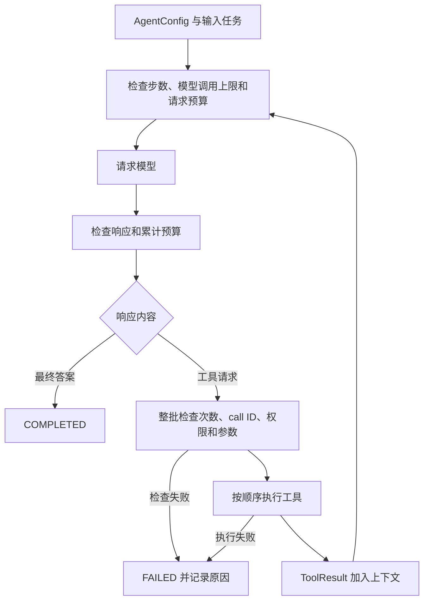

# AgentForge Day 1 学习笔记：自研 Runtime 最小闭环

> 对应任务：原定 2026-10-14 的 Day 1；包含 2026-10-16 补齐的实现。更新日期：2026-10-17（UTC+8）。
> 本文按当前源码、保存的运行证据及用户截图整理。本次只更新笔记，未重新运行测试或改写运行证据。

## 先看当前版本

| 项目 | 10/14 原始版本 | Day 1 补齐后 |
|---|---|---|
| 自动化测试 | 47 项 | 70 项：保留原 47 项，新增 23 项 |
| 标准检查 | 未配置格式工具 | Ruff 静态检查及格式检查 |
| 配置与数据结构 | 配置分散、部分数据为普通字典 | AgentConfig、ToolDefinition、ToolResult、RunState、RunStep、RunEvent 实际接入 |
| 调用限制 | 模型轮数、工具数、时间与预算 | 另有独立 max_model_calls 配置、计数和终止原因 |
| 采购数据 | 写在 demo.py 中 | 来自 examples/procurement/fixtures.json，并严格校验 |
| CLI 验证 | 默认演示及步数限制演示 | 统一脚本执行九个 CLI 检查 |

当前 Day 1 详细清单已通过，完整平台 P0 仍未完成。参考[补齐交付记录](../deliveries/2026-10-16-day1-completion.md)及[P0 事实矩阵](../FEATURE_MATRIX.md)。
原始记录在[10/14 交付记录](../deliveries/2026-10-14-day1.md)，不能把后续成果倒填为当天已经实现。

阅读路线：第一次学习先看第 1–3 节，再运行第 9–10 节；理解执行流程后读第 4–8 节的边界，最后用第 11 节自测。只想解释终端截图时，直接看第 9 节。

## 1. 当天要掌握什么

核心目标：理解怎样把模型提出的工具请求，变成有权限、有校验、有上限、可追踪的执行流程。

学完后，应能够：

- 画出 `model → tool calls → tool results → model` 循环。
- 区分模型请求、工具执行与 Runtime 控制的职责。
- 说明配置、工具请求/结果、运行状态、步骤与事件之间的关系。
- 解释权限检查、参数校验、状态机与预算限制的作用。
- 区分决策轮次、模型调用次数、工具执行次数和步骤顺序号。
- 看懂 pytest 筛选命令、参数化测试和结果摘要。
- 解释为什么 CLI 场景 FAILED、退出码为 1，仍然可以验证通过。
- 用断言证明未授权工具没有执行。
- 准确说明 Mock 测试能证明什么，以及首日尚未完成什么。

建议先运行第 9 节的统一验证入口，再结合第 10 节的实验阅读源码。

## 2. 先理解三个角色

Runtime 是负责安排执行、管理状态、检查限制和记录事件的程序。

| 角色 | 负责什么 | 源码入口 |
|---|---|---|
| ModelAdapter | 接收上下文与工具定义，返回调用请求或最终答案 | [models.py](../../src/agentforge/models.py)：`ModelAdapter.respond` |
| RuntimeEngine | 控制循环、执行顺序、状态、预算和失败终止 | [runtime.py](../../src/agentforge/runtime.py)：`RuntimeEngine.run` |
| ToolRegistry | 注册工具、生成 Schema、检查权限和参数、调用 handler | [tools.py](../../src/agentforge/tools.py)：`ToolRegistry` |

模型返回一个工具请求，并不意味着工具已经执行。请求必须通过 Runtime 和 Registry 的检查。

这里的 handler 是工具实际执行的函数。例如 `calculate_cost` 会用单价和数量计算总价。
首日只注册可信的本地异步函数，没有执行任意用户代码的入口。

### 2.1 新增的数据结构分别解决什么问题

| 数据结构 | 含义与实际用途 | 源码 |
|---|---|---|
| AgentConfig | 一个 Agent 的名称、提示词、Mock 模式、allowlist、限制和版本；实际传入 Runtime | models.py |
| Limits | 步数、模型/工具调用次数、超时与预算配置 | models.py |
| ModelAdapter | 模型适配器的 respond 接口约定 | models.py |
| ModelReply | 本次返回工具请求还是最终文本，以及可选 usage | models.py |
| ToolDefinition | 注册工具名称、说明、参数模型、handler、权限和超时；原名 Tool | tools.py |
| ToolCall | 一次工具请求的 call_id、名称和参数 | models.py |
| ToolResult | 承载实际工具结果，以相同 call_id 加入模型上下文 | models.py |
| RunState | 保存一次执行的状态、计数、输出、步骤与事件；原名 Run | runtime.py |
| RunStep | 记录一次实际模型/工具操作的顺序号、状态、耗时和安全错误码 | models.py |
| RunEvent | 描述事件字典的字段结构，供 RunState.emit 使用 | models.py |

配置和协议值使用严格 Pydantic 模型；需要在执行中更新的状态/步骤使用 dataclass；内部事件用 TypedDict 声明结构。
TypedDict 本身不做运行时校验，dataclass 的类型注解也不自动验证所有赋值；当前事件和步骤由可信源码构造，不是外部写入接口。

当前调用方式示例：

```python
import asyncio

from agentforge.demo import demo_adapter, demo_registry
from agentforge.models import AgentConfig, Limits
from agentforge.runtime import RuntimeEngine

config = AgentConfig(
    allowed_tools=frozenset({"list_supplier_quotes", "get_supplier_detail"}),
    limits=Limits(max_steps=8, max_model_calls=4),
)
run = asyncio.run(
    RuntimeEngine(demo_registry()).run(
        demo_adapter("two-tools"), "Read-only demo", config=config
    )
)
```

这段代码展示内部 Python 调用方式。CLI 和 Python 调用是开发测试入口，平台用户后续通过公开 HTTP/JSON API 接入；当前尚无 REST 服务。

## 3. 一次 Agent Run 如何完成



上图是学习用流程示意，来自 `RuntimeEngine.run`，不是某次实际运行的 Trace；省略了取消和部分异常分支。

### 3.1 工具请求包含什么

项目内部的 `ToolCall` 有三个关键字段：

```json
{
  "call_id": "total-A",
  "tool_name": "calculate_total_cost",
  "arguments": {
    "unit_price_cents": 95000,
    "quantity": 20
  }
}
```

- `call_id`：关联这次请求与对应结果，同一 Run 内不能重复。
- `tool_name`：从已注册工具中查找要执行的函数。
- `arguments`：交给具体工具参数模型校验的数据。

`ToolRegistry.dispatch` 执行 handler 后校验结果能否序列化为 JSON、是否超大，再包装成 `ToolResult`。
Runtime 将其转换为 JSON 可表达的数据加入上下文，结构示意为：

```json
{
  "kind": "tool_result",
  "call_id": "total-A",
  "untrusted": true,
  "result": {"total_cents": 1900000}
}
```

相同 `call_id` 关联请求与结果。`untrusted: true` 表达信任边界；真正阻止越权的是执行入口的代码检查。
当前模型响应约定工具请求和最终文本二选一。这是项目首日 Mock 的内部约定，不是完整的 OpenAI Responses API 协议。

### 3.2 Demo 为什么是 4 步、7 次工具调用

脚本定义在 [demo.py](../../src/agentforge/demo.py) 的 `demo_adapter` 中。

| 模型轮次 | 预设请求/响应 | 本轮工具次数 |
|---|---|---|
| 1 | 查询供应商报价 | 1 |
| 2 | 查询 A/B/C 的交期和保修 | 3 |
| 3 | 分别计算 A/B/C 的采购总价 | 3 |
| 4 | 返回最终文本 | 0 |
| 合计 | 4 轮模型响应 | 7 |

这次运行的 `step_count=4`、`model_call_count=4`、`tool_call_count=7`，同时有 11 个 RunStep：4 个 model 操作加 7 个 tool 操作。
首日工具按模型返回顺序逐个执行，没有并行执行。

### 3.3 三种“次数”和步骤序号不要混淆

| 字段 | 统计对象 | 默认 Demo |
|---|---|---|
| step_count | 决策轮次，在模型请求前递增 | 4 |
| model_call_count | 模型请求尝试次数，失败尝试也计数 | 4 |
| tool_call_count | 已开始的工具调用尝试，包含执行后报错的调用 | 7 |
| RunStep.seq | 全部实际 model/tool 操作的顺序号 | 1–11 |
| RunEvent.event_id | 事件顺序游标，一次操作可以产生多个事件 | 与操作数不同 |

当前没有模型重试，每轮恰好一次模型调用，所以前两项通常相同；独立上限可以设置不同数值，见第 6 节。
未知工具在预检阶段被拒绝，因此不增加 tool_call_count，也不创建实际执行的工具步骤。

## 4. 工具策略：展示能力与执行权限

### 4.1 allowlist 是什么

allowlist 是当前 Run 允许使用的工具名称集合。默认是空集合，未显式授权的工具不能执行。

工具同时有权限分类：

| 分类 | 首日实际行为 |
|---|---|
| `READ_ONLY` | 在 allowlist 中且参数合法，才允许执行 |
| `REQUIRES_APPROVAL` | 返回 `APPROVAL_REQUIRED`，阻断执行 |
| `DENIED` | 返回 `TOOL_FORBIDDEN`，阻断执行 |

首日尚无审批决议接口和“已批准”执行通道；存在 `REQUIRES_APPROVAL` 分类，不等于完整审批功能已经实现。

### 4.2 为什么检查两次

`ToolRegistry.schemas` 只向模型展示 allowlist 中的只读工具。
`ToolRegistry.validate` 在执行入口再次检查实际请求。

模型可能请求没有展示的工具，工具输出也可能诱导模型发出越权请求，因此 Schema 展示不能代替执行授权。

检查顺序是：

1. 工具是否注册。
2. 工具是否在 allowlist 中、是否被禁用。
3. 是否需要审批。
4. 参数是否通过严格校验。

### 4.3 参数校验有什么用

`StrictModel` 使用严格类型和 `extra="forbid"`，具体参数模型约束字段范围。
例如 `CostArgs` 要求单价和数量为有效范围内的整数：

- 数量 `0`：拒绝。
- 数量字符串 `"20"`：拒绝。
- 负数单价：拒绝。
- 添加未定义字段 `bypass`：拒绝。

JSON Schema 从同一参数模型生成，减少文档定义与实际校验不一致的风险。
金额使用整数分，避免本例乘法计算中的浮点小数误差。

### 4.4 整批预检有什么边界

Runtime 先检查整批工具请求，再开始执行。如果第二个请求已经确定非法，第一个也不会执行。

但如果请求都合法，执行第二个工具时发生超时，第一个已经完成的工具不会回滚。
所以整批预检没有提供事务回滚能力。

重复 call ID 会被拒绝；不同 ID 的相同只读请求仍可执行。这个机制也没有提供任意工具的 exactly-once 保证。

### 4.5 fixture 如何成为实际数据源

[fixtures.json](../../examples/procurement/fixtures.json) 保存演示数量、预算以及 A/B/C 的价格、交期和保修。数据为项目自建的合成数据。

| 工具名称 | 数据路径 |
|---|---|
| list_supplier_quotes | 读取并校验 fixture，返回供应商及单价 |
| get_supplier_detail | 读取并校验 fixture，返回指定供应商的交期和保修 |
| calculate_total_cost | 用传入的整数单价与数量相乘；数据可以来自前一个工具的返回值 |

`load_fixtures` 检查字段类型、取值范围，并要求 A/B/C 各出现一次。负数价格、重复供应商和损坏 JSON 都会被拒绝。
路径固定在源码中，模型不能选择任意文件。当前演示依赖源码 checkout 和 editable 安装，尚未提供包含 fixture 的独立 wheel。

`test_tools_load_actual_fixture_values` 用临时 fixture 副本修改价格和交期，实际分派三个工具，检查返回值与总价变化，证明数据不再只是写死在工具函数里。

## 5. 状态机：任务不能随意改变状态

首日状态关系：

```text
CREATED → RUNNING → COMPLETED
                  → FAILED
                  → CANCELLED
```

`RunState.transition` 集中检查合法迁移。例如任务已经 `COMPLETED`，再次转为 `RUNNING` 会抛出 `INVALID_STATE_TRANSITION`；Runtime 也拒绝重用已经结束的 RunState。

状态表示任务当前处于什么阶段；`stop_reason` 进一步解释终止原因。

| 原因码 | 含义 |
|---|---|
| `FINAL_ANSWER` | 模型返回最终答案 |
| `MAX_STEPS` | 达到决策轮次上限 |
| `MAX_MODEL_CALLS` | 达到模型请求尝试次数上限 |
| `MAX_TOOL_CALLS` | 工具调用次数将超过上限 |
| `UNKNOWN_TOOL` | 请求未注册工具 |
| `TOOL_ERROR` | 工具执行或结果处理异常 |
| `TOOL_FORBIDDEN` | 工具没有执行权限 |
| `INVALID_TOOL_ARGUMENTS` | 工具参数不合法 |
| `TOOL_TIMEOUT` | 工具调用超时 |
| `MODEL_TIMEOUT` | 模型调用超时 |
| `WALL_TIME_LIMIT` | 整个 Run 达到时间上限 |
| `TOKEN_BUDGET` | 达到预算限制 |

当天还没有审批等待、进程中断核对和安全点恢复状态。

### 5.1 完成、失败和取消都要结束步骤

每次实际模型或工具操作创建一个 RunStep，记录 started_at、kind、seq；结束时填写状态、duration_ms，失败时保存安全错误码。
在当前内存执行范围，已返回或已取消的任务不应留下 RUNNING 的活动步骤。

调用方取消运行协程时，Runtime 将活动步骤与 RunState 标记为 CANCELLED，记录原因和事件，再传播 `asyncio.CancelledError`，保留上层取消语义。
调用方可以预先创建 RunState 并通过 `state=` 传入，在捕获取消后检查终态。它不会通过普通 return 返回一个“成功完成”的 Run。
对应测试：`test_cancellation_preserves_observable_state_and_steps`。

## 6. 为什么需要多种限制

| 限制 | 控制的风险 |
|---|---|
| max_steps | 决策轮次持续增加 |
| max_model_calls | 模型请求尝试消耗超过单独配置的额度 |
| 最大工具调用次数 | 单轮或多轮产生过多调用 |
| 单次模型/工具超时 | 某一次调用长期等待 |
| 整个 Run 的时间上限 | 多次调用累计运行过久 |
| token 预算 | 上下文和模型消耗持续增长 |
| 输入/输出大小 | 过大数据进入系统或上下文 |

例如将 max_steps 设为 8、max_model_calls 设为 2，重复请求会在第 3 次模型调用前以 MAX_MODEL_CALLS 结束。
如果两项同时触发，当前实现先检查 max_steps，因此记录 MAX_STEPS。
最后一次允许的模型请求若正常返回最终答案，仍可完成；达到额度不等于必须将该响应判为失败。

需要区分两种重复：

- 相同 call_id：立即以 DUPLICATE_CALL_ID 拒绝，不重放该调用。
- 不同 call_id、重复同一只读行为：允许在权限范围内执行，但受次数、时间和预算限制；repeat 场景用于验证这条路径。

需要准确说明的边界：

- 缺少真实 usage 时，使用序列化请求与响应的 UTF-8 字节数作为预算代理，标记为 `utf8_bytes_estimate`，不是真实 token 计数。
- 响应后发现超预算，会阻止后续工具执行；已经发生的模型调用无法撤销。
- 当前成本为 `null`，含义是 unknown，不能解释成真实成本为零。
- 异步超时依赖协作式取消，不能保证强制终止阻塞或忽略取消的函数。

## 7. 事件如何帮助定位问题

事件示例包括：

```text
run.created → run.started
model.requested → model.responded
tool.requested → tool.started → tool.completed / tool.failed
run.completed / run.failed
```

事件包含 Run ID、顺序游标、时间戳、模式、关联信息及部分实测耗时。可以据此判断执行到了哪一步、失败原因是什么。
时间戳用于定位发生时间；耗时使用单调时钟差值计算。

RunStep 表示一个操作的执行摘要；RunEvent 表示过程中的一个事件。一次工具操作可以产生 requested、started、completed 三个事件。
RunEvent.step_id 关联 RunStep.seq；Run 创建阶段为 0，终止事件可关联最近一个步骤，不表示终止时又调用了一次工具。

首日事件只记录元数据，不包含输入、工具参数、结果和最终文本原文；因此排查细节有限。
原始上下文在执行过程中仍存在于内存，CLI 还会输出 Demo 最终结果，不能将其理解为所有敏感信息都已自动脱敏。

当前事件只在内存中，进程退出会丢失。事件记录不等于持久化 Checkpoint，也没有提供重启恢复。

## 8. Mock 可以证明什么

`DeterministicMockAdapter` 按预设脚本返回工具请求或最终文本，不需要真实模型 Key，也不访问模型服务。

它适合验证：

- 多轮与多工具控制流是否正确。
- 校验失败后工具是否没有执行。
- 超时、预算和异常是否产生明确终止。
- 事件顺序与状态是否符合断言。

当前默认 Demo 在组装脚本时读取 fixture，生成调用参数和最终比较摘要。因此，修改 fixture 后重新启动 Demo，摘要可以随 fixture 改变；它仍不是对工具返回结果的智能分析。

要证明数据确实沿执行链路传递，阅读 `test_serial_tools_return_results_before_next_model_call`：

1. 第一次模型响应请求报价。
2. 测试适配器从上下文读取实际报价，再用该价格请求总价工具。
3. 最后一次模型响应读取实际计算结果并返回文本。

这验证了多轮结果传递。默认 CLI 摘要和测试适配器的数据检查承担不同作用，两者都不证明真实模型任务质量。
`repeat_last=True` 则让 Mock 使用新 call ID 持续返回同一动作，直到 Runtime 按上限终止。

## 9. 读懂统一验证脚本和 pytest 输出

### 9.1 一个命令实际执行了什么

```powershell
.\.venv\Scripts\python.exe scripts/verify_day1.py
```

入口：[verify_day1.py](../../scripts/verify_day1.py)。它使用当前虚拟环境解释器，按以下顺序启动子进程：

| 阶段 | 实际检查 | 通过条件 |
|---|---|---|
| 静态检查 | ruff check src tests scripts | 所选 lint 规则无报错 |
| 格式检查 | ruff format --check src tests scripts | 文件已经符合格式，无需修改 |
| 自动化测试 | pytest -q | 断言全部通过 |
| CLI 检查 | 九次 python -m agentforge.demo | 退出码、状态、终止原因、调用数符合预期，步骤已收尾 |
| 环境记录 | pip freeze | 保存实际安装版本 |

脚本移除子进程中名称以 API_KEY 结尾的环境变量；Mock 没有模型网络请求。首次安装依赖仍可能需要访问包仓库。
这里的 Ruff 没有执行全面类型检查或安全审计；通过其当前配置不代表所有缺陷都被发现。

脚本会把本次输出写入 `docs/evidence/day1-completion/`，例如 [pytest 结果](../evidence/day1-completion/pytest.txt)；再次运行会更新该目录中的同名证据文件。
`docs/evidence/` 根目录的 10/14 原始证据仍保留。

### 9.2 截图前半部分怎么读

用户最近提供的截图与本次读取的[保存输出](../evidence/day1-completion/pytest.txt)包含：

```text
All checks passed!
9 files already formatted
......................................................................   [100%]
70 passed in 1.35s
```

| 输出 | 正确解释 |
|---|---|
| All checks passed! | 此处是 Ruff 静态检查的结果，不是后面所有阶段的总结果 |
| 9 files already formatted | 被检查的九个 Python 文件格式符合规范；format --check 没有改写它们 |
| 每个点 | pytest 中一个通过的测试实例 |
| 100% | 本次测试执行进度，不是准确率或代码覆盖率 |
| 70 passed | 全部七十项 pytest 实例通过，包括参数化实例 |
| in 1.35s | 该次 pytest 耗时，不是 Agent 或真实模型响应延迟 |

早先补齐交付时记录为 `70 passed in 0.70s`，属于另一次运行；本次读取文件为 1.35s。测试数量与断言结论相同，不能把两次耗时混写成一次测量。

### 9.3 九条 CLI 结果如何解读

一行结果示例：

```text
two-tools: COMPLETED / FINAL_ANSWER, model_calls=3, tool_calls=2, exit=0
```

依次表示：验证用例名称、Run 最终状态、终止原因、模型请求尝试数、工具执行尝试数、该 CLI 子进程退出码。
日志中的 model_calls/tool_calls 对应 JSON 的 model_call_count/tool_call_count。

| 验证用例 | 模型/工具尝试次数 | 状态 / 终止原因 | 学习重点 |
|---|---|---|---|
| demo | 4 / 7 | COMPLETED / FINAL_ANSWER | 默认采购比较，三种工具参与多轮执行 |
| direct | 1 / 0 | COMPLETED / FINAL_ANSWER | 无需工具也能完成 |
| single-tool | 2 / 1 | COMPLETED / FINAL_ANSWER | 工具执行后回到模型 |
| two-tools | 3 / 2 | COMPLETED / FINAL_ANSWER | 两轮各执行一个工具，第三次模型响应结束 |
| unknown-tool | 1 / 0 | FAILED / UNKNOWN_TOOL | 未注册工具在执行前被拒绝 |
| tool-error | 1 / 1 | FAILED / TOOL_ERROR | 工具已经开始，但显式注入的本地异常导致失败 |
| repeat-steps | 2 / 2 | FAILED / MAX_STEPS | 新 call ID 的重复行为达到决策轮次上限 |
| repeat-model | 2 / 2 | FAILED / MAX_MODEL_CALLS | 新 call ID 的重复行为达到模型调用上限 |
| limit | 1 / 1 | FAILED / MAX_STEPS | 默认任务仅允许一轮，在下一次模型请求前停止 |

这些名称来自验证脚本，不完全等于 CLI 的 --scenario 参数。例如 demo 对应默认 procurement，repeat-steps/repeat-model 都使用 repeat 场景，只是上限参数不同。
九次 CLI 检查独立于七十项 pytest，不能把它们写成“79 项 pytest”。

**为什么出现 FAILED / exit=1，整体仍通过？**

验证目标包括受控失败。正常完成场景预期退出码为 0；未知工具、工具异常和超限场景预期为 1。
`capture` 核对退出码，脚本随后检查状态、原因和调用次数。只有全部符合断言才继续；工具越权执行、原因不符或错误退出码都会导致验证失败。
所以，Run 失败是某个模拟任务的结果；验证通过表示系统按预期处理了这个结果。
全部检查通过时，统一验证脚本自身正常退出；五个故障演示子进程的 exit=1 是它明确接受并检查的预期值。

详细对应输出见 [CLI 摘要](../evidence/day1-completion/smoke.txt)、[串行两工具](../evidence/day1-completion/two-tools.json)、[未知工具](../evidence/day1-completion/unknown-tool.json)和[模型调用上限](../evidence/day1-completion/repeat-model.json)。

### 9.4 如何只选择部分测试

在项目根目录运行：

```powershell
.\.venv\Scripts\python.exe -m pytest -v -k "policy_blocks_side_effects or untrusted_injection or terminal_state"
```

| 命令部分 | 含义 |
|---|---|
| `.\.venv\Scripts\python.exe` | 使用项目虚拟环境中的 Python |
| `-m pytest` | 启动 pytest |
| `-v` | 显示每项测试的详细名称和结果 |
| `-k "… or …"` | 按名称等关键词筛选，任意一个条件匹配即可 |

### 9.5 为什么筛选后有五项测试

`test_policy_blocks_side_effects` 使用三组参数，分别产生一个测试实例；再加上注入和状态测试，共五项。

| 截图中的测试 | 模拟情况 | 预期行为 |
|---|---|---|
| `READ_ONLY-allowed0-TOOL_FORBIDDEN` | 工具标为只读，但 allowlist 为空 | 拒绝且不执行 handler |
| `DENIED-allowed1-TOOL_FORBIDDEN` | 工具在 allowlist 中，但被禁用 | 拒绝且不执行 handler |
| `REQUIRES_APPROVAL-allowed2-APPROVAL_REQUIRED` | 工具在 allowlist 中，但需要审批 | 阻断且不执行 handler |
| `test_untrusted_injection_cannot_change_policy` | 工具返回诱导写入的文本，Mock 随后请求写入 | 写入仍被策略层阻断 |
| `test_terminal_state_cannot_restart` | 尝试把 COMPLETED 改回 RUNNING | 拒绝非法迁移 |

`allowed0/1/2` 是 pytest 自动生成的参数标识，不表示三种权限等级；实际集合内容要看测试源码。
注入测试预设了后续写入请求，验证的是执行策略没有被绕过，没有验证真实模型会怎样响应注入文本。

### 9.6 PASSED 为什么可以代表“操作被拒绝”

测试的预期就是阻断非法行为。检查点来自 [test_runtime.py](../../tests/test_runtime.py) 中的 `test_policy_blocks_side_effects`：

```python
effects = []

async def handler(args):
    effects.append("write")
    return {}

# 创建测试工具并发起请求后，验证：
assert run.stop_reason == expected and effects == []
```

`effects` 是测试用的内存列表，模拟 handler 执行产生的副作用，并非真实数据库或采购系统。
列表保持为空，配合正确的拒绝原因，证明该用例中 handler 没有执行到写入语句。
`PASSED` 表示断言符合预期，不表示写入成功。

### 9.7 早期截图中的 47 项应如何理解

早期、补齐前的用户截图显示：

```text
collected 47 items / 42 deselected / 5 selected
5 passed, 42 deselected in 0.25s
```

- `47 items`：发现了 47 个测试实例。
- `5 selected`：本次筛选后执行了五项。
- `42 deselected`：其余 42 项本次未执行，不是失败，也不代表这次运行验证了它们。
- `5 passed`：执行的五项都符合断言。
- `0.25s`：这次测试的耗时，不是 Agent 延迟基准或模型响应速度。
- 右侧 `20% → 100%`：所选五项的完成进度，不是准确率或覆盖率。

该摘要来自用户截图，本文未再次运行这条命令，也未保存截图文件。
首日另有完整运行证据：[day1-pytest.txt](../evidence/day1-pytest.txt)，当时为 `47 passed in 0.48s`。两次测试范围和耗时应分别理解。
当前全量测试已扩展到 70 项；在测试集合不变且仍选中这五项时，预期其余 65 项被 deselected，以实际输出为准。47 不是当前的全量测试数。

## 10. 动手实验与源码阅读顺序

以下命令在项目根目录执行，假定已按 [README](../../README.md) 安装依赖；不需要真实模型 Key。
这里列出操作与预期结果，不表示整理本文时重新执行过。

### 实验 A：观察完整循环

```powershell
.\.venv\Scripts\python.exe -m agentforge.demo
```

观察 `status=COMPLETED`、`step_count=4`、`model_call_count=4`、`tool_call_count=7`，并检查 steps 中有 11 个操作。
在事件中找到一次模型请求、工具开始和工具完成，追踪 step_id 与步骤 seq 的对应。
比较实际输出与[补齐后的 Demo 证据](../evidence/day1-completion/demo.json)：UUID、时间戳和耗时可以变化，fixture 与脚本不变时，调用顺序和业务输出应一致。

### 实验 B：观察限制终止

```powershell
.\.venv\Scripts\python.exe -m agentforge.demo --max-steps 1
```

预期第一轮报价工具执行完成，下一轮模型请求前触发 `FAILED / MAX_STEPS`，退出码为 1。
这属于符合预期的限制终止，可以对照[限制演示证据](../evidence/day1-completion/limit.json)。

### 实验 C：观察权限和状态测试

执行第 9 节的筛选命令，然后打开对应测试，逐项找出输入、预期错误码和副作用断言。

### 实验 D：区分两项独立上限

```powershell
.\.venv\Scripts\python.exe -m agentforge.demo --scenario repeat --max-steps 2
.\.venv\Scripts\python.exe -m agentforge.demo --scenario repeat --max-model-calls 2
```

分别观察 MAX_STEPS 和 MAX_MODEL_CALLS。两次都应是两次模型请求、两次工具执行，退出码为 1；工具 call_id 不重复，说明终止来自上限而非重复 ID 检查。

### 实验 E：确认数据与结果真正参与执行

```powershell
.\.venv\Scripts\python.exe -m pytest tests/test_day1_contract.py -v -k "tools_load_actual_fixture_values or serial_tools_return_results"
```

第一个测试用临时 fixture 副本改变数据，再检查实际工具结果；第二个测试检查报价如何进入下一次调用，以及计算结果如何进入最终响应。
完成后再运行统一验证脚本，区分静态检查、格式检查、pytest 与 CLI 四类结论。

### 推荐阅读顺序

| 顺序 | 文件 | 阅读目标 |
|---|---|---|
| 1 | [demo.py](../../src/agentforge/demo.py)、[fixtures.json](../../examples/procurement/fixtures.json) | 理解任务、工具、固定脚本和数据源怎样组装 |
| 2 | [models.py](../../src/agentforge/models.py) | 理解配置、请求/结果、步骤/事件与适配器边界 |
| 3 | [tools.py](../../src/agentforge/tools.py) | 跟踪 schemas → validate → dispatch |
| 4 | [runtime.py](../../src/agentforge/runtime.py) | 跟踪一次完整循环与每个失败出口 |
| 5 | [test_runtime.py](../../tests/test_runtime.py)、[test_day1_contract.py](../../tests/test_day1_contract.py) | 理解如何验证状态、副作用、fixture、上限和多轮数据传递 |
| 6 | [verify_day1.py](../../scripts/verify_day1.py) | 理解子进程、预期退出码、断言和证据保存 |

## 11. 自测问题与参考答案

1. **模型提出工具调用后，要经过哪些检查？**

   次数和重复 call ID 检查，以及注册、allowlist、权限和参数校验；调用还有超时与结果检查。

2. **为什么工具已向模型展示，执行时还要校验？**

   模型输出仍是待验证请求，展示不能授权；真正的权限边界在执行入口。

3. **为什么整批预检不等于事务回滚？**

   它可以提前发现已知非法请求；执行中失败不会撤销此前已经完成的调用。

4. **为什么 Mock 测试通过不能代表真实模型质量？**

   模型行为由固定脚本决定。测试验证控制逻辑，没有评估真实模型理解、决策和任务完成能力。

5. **为什么已有状态和事件，还不能重启恢复？**

   当前只保存在内存，未实现数据库持久化、一致性 Checkpoint 和合法续传。

6. **为什么拒绝重复 call ID 还不能保证写入幂等？**

   当前集合仅在一次运行中存在，不同 ID 也可能表达同一写入；未来还需要审批、数据库唯一约束、幂等键与未知结果核对。

7. **默认 Demo 的四轮、七次调用和十一个步骤分别是什么？**

   四轮模型决策，七次工具执行尝试；每次模型/工具操作各有一个 RunStep，总计十一个。事件数还会更多，因为一次操作产生多个事件。

8. **为什么 max_steps 与 max_model_calls 相同计数，却还分别配置？**

   分别表达决策轮次和模型请求尝试的上限；当前没有重试，所以计数通常相同，但任一较小上限均可独立终止。

9. **为什么五个 FAILED 场景仍然验证通过？**

   它们预期因未知工具、工具异常或上限而失败。验证的是状态、原因、次数和退出码符合断言，而非所有 Run 都必须完成。

10. **为什么不直接使用 LangGraph Runner？**

    PRD 要求源码实现并展示控制核心，所以选择小型顺序执行器。代价是自行维护状态、错误、取消和后续恢复逻辑；成熟框架是替代方案，不能因此声称自研具有生产优势。

## 12. 学习与成果表述的边界

- 补齐后完成 Day 1 详细清单：类型、fixture、自研 Mock Loop、工具策略、状态/步骤/事件、独立上限、Ruff 与测试；完整平台 P0 尚未完成。
- 保存的当前结果为 70 项 pytest 通过、0 失败，另有九次 CLI 检查符合预期；不构成 JSONL Evals 数据集、Live 质量指标或完整代码覆盖率结论。
- 当天未实现 MCP、真实模型适配器、REST/OpenAPI、React、SQLite、人工审批恢复和 JSONL Evals。
- 需审批工具被阻断，不代表批准、拒绝、重复批准和恢复流程已经通过验收。
- 产品面向不同语言开发者；本周用 Python 实现服务端，后续通过 HTTP/JSON/OpenAPI 接入，不等于已实现多语言 Runtime。
- Codex 负责本次代码实现；候选人按实际参与情况说明需求、决策、审阅、验收与讲解贡献。

后续复习可结合[设计决策](../DECISIONS.md)、[故障复盘](../FAILURE_MODES.md)与[实际结果](../RESULTS.md)。
