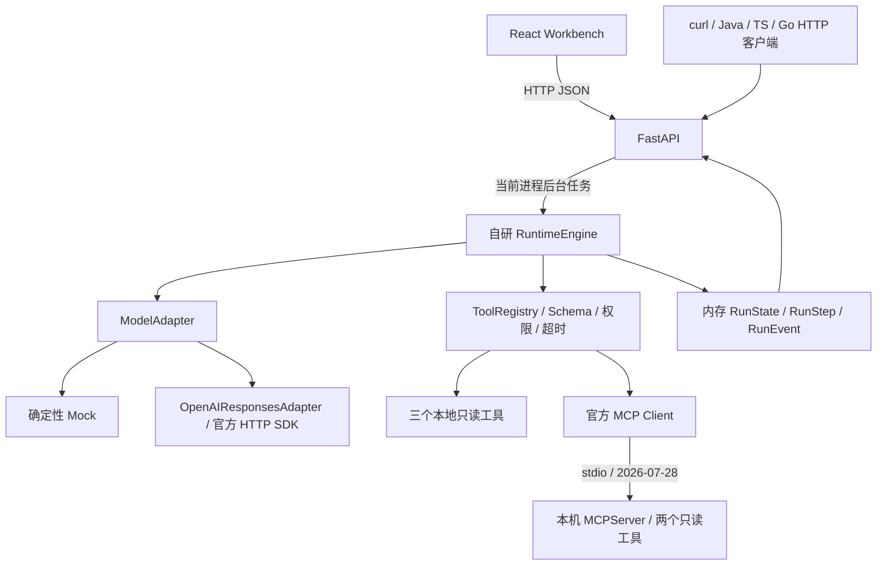

# AgentForge Day 2 学习笔记：模型接入、MCP、API 与 Web Workbench

> 对应 PRD 原定 10/15 的 Day 2 任务；实际交付日期为 2026-10-17。整理日期：2026-10-18（UTC+8）。
> 根据当前源码、交付记录和已保存的运行证据整理。本次只新增笔记，没有重新执行测试或外部模型调用。

阅读路线：先读第 1–2 节建立整体认识，再按第 9 节动手；第 3–6 节对应源码，最后用第 10 节自测。
前置知识见 [Day 1 笔记](2026-10-14-day1.md)；实际完成范围见 [Day 2 交付报告](../deliveries/2026-10-17-day2.md)和[P0 事实矩阵](../FEATURE_MATRIX.md)。

## 1. Day 2 要学会什么

核心目标：把 Day 1 的内存执行器接到外部协议和用户界面，同时保留 Runtime 对执行的控制权。

| Day 1 已有能力 | Day 2 增量 | 学习重点 |
|---|---|---|
| 确定性 Mock | OpenAIResponsesAdapter | 模型 HTTP 适配与执行循环分开 |
| 三个本地工具 | 两个真实 MCP 工具 | 协议互操作、发现、生命周期和错误转换 |
| 工具 Schema 与策略 | 本地/MCP 统一 Registry | 工具来源不同，执行策略入口相同 |
| CLI 启动与查看 | FastAPI、OpenAPI、curl | 语言无关的公开契约 |
| 内存步骤/事件 | React/TS Workbench 轮询展示 | 页面展示真实后端状态 |
| 70 项测试 | 全量 107 项及浏览器/curl 检查 | 区分测试层次与成果边界 |

学完应能独立解释：

- SDK 负责什么，Runtime 保留哪些职责。
- function_call、call_id、function_call_output、reasoning 如何参与多轮调用。
- MCP Host、Client、Server 分别是谁，为什么“发现工具”不等于“授权工具”。
- HTTP 成功、Run 成功和测试通过之间的区别。
- 为什么当前后台任务不具备重启恢复能力。
- 107 项通过能证明什么，以及 Live 为什么仍然未测。

## 2. 先画出整个系统



这是根据源码绘制的结构示意，不是某次执行的 Trace。

| 组件 | 负责的事情 | 不应混淆的边界 |
|---|---|---|
| OpenAI SDK | 模型 HTTP 请求、响应解析 | 不负责本项目 Agent Loop |
| MCP SDK | MCP 协议、传输与客户端/服务端生命周期 | 不负责授予业务工具权限 |
| RuntimeEngine | 决策循环、次数/预算、工具分派、状态和事件 | 仍由项目源码实现 |
| FastAPI | 请求验证、资源操作、统一 JSON、OpenAPI | 当前只管理进程内任务 |
| React Workbench | 配置、发起请求、轮询并展示 | 不直接执行工具或连接 MCP |

源码主链路：`api.py:create_run → execute → RuntimeEngine.run → adapter.respond / registry.dispatch`。
替换模型或增加工具传输方式，都不能绕开 Runtime 和 Registry 的检查。

## 3. 模型接入：学习 Responses 协议与适配器边界

入口：[openai_adapter.py](../../src/agentforge/openai_adapter.py)。

### 3.1 三种“模型名称”概念要分清

| 位置 | 取值/来源 | 含义 |
|---|---|---|
| AgentConfig.model_adapter | mock / openai | 内部使用哪类适配器 |
| 创建 Run 的 mode | mock / live | 本次执行模式，覆盖该次使用的适配器选择 |
| 真实模型 ID | 服务端 OPENAI_MODEL | 提供商实际调用的模型，不在代码中设默认真实模型 |

OPENAI_API_KEY 也来自服务端环境；浏览器不提交或保存 Key。应用不自动加载 `.env`，配置示例见 [.env.example](../../.env.example)。
创建 Agent 可以保存 openai 模式的配置；缺少真实模型配置时，其 model_name 显示 not_configured，不能把“Agent 创建成功”解释成“模型接入成功”。

### 3.2 function_call 与 function_call_output 如何关联

以下是协议字段的学习示意，不是本次外部 API 的实测响应：

```json
{
  "type": "function_call",
  "id": "fc_example",
  "call_id": "call_example",
  "name": "calculate_total_cost",
  "arguments": "{\"unit_price_cents\":95000,\"quantity\":20}"
}
```

- id 标识提供商的输出项。
- call_id 用来关联这次工具请求和工具结果。
- arguments 是 JSON 字符串，适配器先解析为对象，再交给 Runtime/Registry 校验。

工具实际执行后，适配器构造下一轮输入：

```json
{
  "type": "function_call_output",
  "call_id": "call_example",
  "output": "{\"total_cents\":1900000}"
}
```

关联的是 call_id，不是输出项 id，也不是工具名称。一轮请求多个工具时，每个结果都需要对应正确的 call_id，并保持处理顺序。
项目内的 ToolResult 先进入统一上下文，OpenAIResponsesAdapter 再将它翻译成上述提供商协议格式。

### 3.3 reasoning 为什么不能压成普通聊天消息

reasoning、function_call、function_call_output 是不同类型的协议项。只保留 role/content 会丢失工具关联和续传信息。

当前实现：

1. 使用 store=false，不依赖 previous_response_id。
2. 将可重放输出项放进内部 ModelReply.continuation。
3. 对 reasoning 只保留必要标识和不透明 encrypted_content；不保存隐藏原文或摘要。
4. 下轮请求按原顺序重放协议项，并追加工具结果；系统提示词仍作为 instructions 提交。
5. 需要工具续传但 reasoning 加密状态缺失时，返回 MODEL_CONTINUATION_UNAVAILABLE，工具不执行。

continuation 只在本次运行上下文中存在，不进入公开 RunView、步骤或事件，当前也没有磁盘 Checkpoint。
store=false 不等于账户已启用 Zero Data Retention，更不代表所有提供商数据保留政策已由本项目解决。

### 3.4 模型返回结果也需要验证

| 情况 | 当前处理 |
|---|---|
| completed 且返回合法函数请求 | 交给 Runtime 做工具预检 |
| completed 且返回最终文本 | 正常完成 |
| 整体响应 incomplete | MODEL_INCOMPLETE |
| 函数调用项本身 incomplete | MODEL_PROTOCOL_ERROR，不分派 |
| 拒绝、空输出、非法 JSON | 明确失败，不当作成功答案 |
| 401/403 | PROVIDER_AUTH |
| 429 | PROVIDER_RATE_LIMIT |
| 5xx / 网络不可用 | PROVIDER_UNAVAILABLE |
| 调用超时 | MODEL_TIMEOUT |

SDK 的自动重试被关闭。这样一次 Runtime 模型调用尝试不会在 SDK 内悄悄变成多次请求，次数预算和失败原因更容易解释。
当前单次输出上限为 2048 token；整个 Run 仍由 Runtime 检查预算。缺少价格时成本为 unknown，不把 Mock 或未配置价格解释成真实费用为零。

对应测试：[test_openai_adapter.py](../../tests/test_openai_adapter.py)。这些是合成 HTTP fixture，经真实 SDK 解析；**不是外部 Live API 实测**。

## 4. MCP：学习真实客户端—服务端互操作

入口：[mcp_server.py](../../src/agentforge/mcp_server.py)、[mcp_adapter.py](../../src/agentforge/mcp_adapter.py)。

### 4.1 Host、Client、Server 分别是谁

| 角色 | 本项目对应组件 |
|---|---|
| Host | AgentForge 应用：组织模型、工具与执行策略 |
| Client | MCPClientAdapter 内使用的官方 Client |
| Server | 单独启动的本机 MCPServer 子进程 |

Web 页面通过 HTTP 调 API；API/Runtime 再经 MCP Client 调 Server。React 本身不是 MCP Client。

| 通信边界 | 协议/传输 | 地址或入口 |
|---|---|---|
| 浏览器 → API | HTTP/JSON，经 Vite 代理 | Web 5173，API 8000 |
| MCP Client → Server | MCP over stdio | 固定 python -m agentforge.mcp_server，无独立 TCP 端口 |
| Live 适配器 → 模型提供商 | 官方 Responses HTTP 接口 | 仅在 Live 配置齐全并启动任务时使用 |

### 4.2 为什么要核对锁定版本

本次实际版本为 mcp=2.3.0、mcp-types=2.3.0，目标协议 2026-07-28。
SDK 要求 Pydantic≥2.12，Day 1 的 2.11.7 不满足，因此升级为固定 2.14.1，再回归原 70 项测试。
版本与安装后 API 签名见 [sdk-versions.json](../evidence/day2/sdk-versions.json)，依赖完整记录见 [environment.txt](../evidence/day2/environment.txt)。

使用 v2 的 MCPServer、Client、input_schema、structured_content、is_error 等实际 API。
Client 默认 auto，通过 server/discover 探测；应用检查实际 protocol_version 必须为 2026-07-28，没有手写旧 initialize 流程。
这只证明当前版本与本机 stdio 工具子集已验证，不是完整 MCP 协议认证。

### 4.3 发现、注册、执行是三个动作

1. **发现：**连接 Server，list_tools 获取工具名称、说明和 Schema。
2. **注册：**只保留两个固定名称，加 mcp_ 前缀后加入统一 Registry。
3. **执行：**模型请求这些名字时，仍通过权限、Schema 和超时检查，再调用 Client.call_tool。

实际注册的是 mcp_list_supplier_quotes 和 mcp_get_supplier_detail；原来的三个 local 工具仍保留。
服务端 annotations 中的 read_only_hint 是提示。实际授权来自本项目固定目标、名称名单和 Registry 策略，不能只看注解就信任任意 Server。

### 4.4 生命周期有什么代价

每次发现和调用各自使用 async with Client(...)，自行打开和关闭连接/stdio 子进程。
这样避免把 SDK 的取消作用域跨请求共享，但每次调用都有进程启动开销；本次没有做持久连接池或吞吐基准。
Server 目标由源码固定，HTTP 请求和模型不能传入安装命令、任意 URL 或任意子进程参数。

### 4.5 真实调用暴露了什么问题

早期实现中，带普通 dict 返回注解的这两个工具只有文本内容，structured_content 为 null；import、发现和“调用未抛异常”都不足以证明结果可用。
修复为显式 QuotesOutput/DetailOutput 模型，由 SDK 生成真实结构化输出；Client 再检查 is_error、结果对象及大小。

另外，SDK 生命周期可能把异常包装成 ExceptionGroup。应用需要保留已知安全原因码，避免将结果格式错误误报为普通断连。
对应 [初始失败复现](../evidence/day2/initial-mcp-failure.txt)和 [MCP 集成测试](../../tests/test_mcp_adapter.py)。

## 5. 统一工具策略：本地和 MCP 共用执行入口

入口：[tools.py](../../src/agentforge/tools.py)。

| 检查 | 本地工具 | MCP 工具 |
|---|---|---|
| 注册/allowlist/权限 | 同一 Registry | 同一 Registry |
| 参数结构 | JSON Schema + 严格 Pydantic | 发现的 JSON Schema，并拒绝额外参数 |
| 超时与错误 | RuntimeFault 安全原因码 | MCP 错误转为 RuntimeFault |
| 结果 | 必须可表达为 JSON，限制大小 | 检查 SDK is_error/结构化结果，再经过公共结果入口 |

工具元数据通过 GET /api/tools 暴露，包含 source=local/mcp、permission、input_schema 和 timeout_seconds。
模型看到的 Schema 仍会按当前 Agent allowlist 过滤，执行时再次检查。
例如 supplier 只能是 A/B/C；穿越样式字符串、错误类型、缺参和额外 command 字段都会拒绝。这些测试没有执行任意文件或命令，也不能被解读为通用沙箱安全证明。

超时为 MCP_TIMEOUT，断连为 MCP_UNAVAILABLE，工具错误为 MCP_TOOL_ERROR。Run 明确失败，不让模型或 SDK 无限重试。
需审批工具仍被阻断，完整审批和写入路径尚未实现。

## 6. API：学习资源契约、异步状态和进程边界

入口：[api.py](../../src/agentforge/api.py)。

### 6.1 为什么提供 HTTP，而不是要求客户端导入 Python 类

服务端用 Python 实现；外部只需要按 JSON 契约发送 HTTP 请求。
curl、React、Java、Go 等使用相同端点，不需要理解 RuntimeEngine 或加载 Python 对象。这不等于已经提供其他语言 Runtime 或官方 SDK。

| 接口组 | 用途 |
|---|---|
| GET /health | 配置就绪状态、内存存储、MCP 版本/协议 |
| GET/POST /api/agents，GET /api/agents/{agent_id} | 创建、列出和查询 Agent |
| GET /api/tools | 工具能力和策略元数据 |
| POST /api/runs，GET /api/runs | 启动、分页列出 Run |
| GET /api/runs/{run_id} | 查询状态、原因、输出和计数 |
| GET /api/runs/{run_id}/steps、/events | 查询步骤及事件游标 |
| GET /openapi.json | 实际生成的机器可读规范 |

成功响应为 `{data, request_id}`；错误为 `{error: {code, message, request_id}}`。OpenAPI 标准文档本身不套 data。
request_id 便于定位一次 HTTP 请求，run_id 关联同一任务；轮询同一 Run 的不同请求会有各自的 request_id。
完整字段、范围和错误码见 [API 契约](../API_CONTRACT.md)。

### 6.2 HTTP 成功不等于 Run 完成

| 情况 | HTTP 行为 | Run 结果 |
|---|---|---|
| 合法任务被接受 | POST 返回 202 和 run_id | 客户端继续查询，不保证已执行完 |
| 任务稍后因无工具权限失败 | GET 查询仍可返回 200 | data.status=FAILED，stop_reason=TOOL_FORBIDDEN |
| Live 缺 Key 或模型配置 | POST 返回 503 / LIVE_NOT_CONFIGURED | 此次 Run 未创建，不回退 Mock |
| 查询不存在的 Run | GET 返回 404 / RUN_NOT_FOUND | 没有对应资源 |

200 表示查询请求成功；202 表示任务已接受。最终业务执行状态要看 data.status 和 stop_reason。
422 表示请求不合法，响应不回显敏感输入或 Python ValidationError/堆栈。

### 6.3 为什么后台任务不是可靠队列

API 使用 asyncio.create_task，保留任务强引用，正常关闭时取消任务；模型客户端和 MCP 连接也需要清理。
但 Agent/Run/Step/Event 全在当前进程内存中，重启会丢失，不能从安全断点继续。

当前最多四个活动 Run、二百条 Run 历史、一百个 Agent，容量满返回 409；仅使用一个 worker。
这些是本机资源上限，不是吞吐测试结果；没有消息持久化、租约或跨 worker 协调。
重复 POST 会创建独立 ID，没有请求幂等键；只读任务可重复，不代表未来写入操作已经实现幂等。

## 7. React/TypeScript：界面怎样显示真实执行

入口：[main.tsx](../../apps/web/src/main.tsx)，代理配置见 [vite.config.ts](../../apps/web/vite.config.ts)。

1. 页面启动，读取 agents、tools 和 health。
2. 创建 Agent 时 POST 配置，成功后把返回的 Agent 加入选项。
3. 启动 Run 时发送 agent_id、input、mode 和 Mock 场景。
4. 创建成功后查询 Run 与 steps；处于 CREATED/RUNNING 时继续轮询。
5. 渲染后端步骤的名称、状态、耗时和错误码，终态停止轮询。

运行面板的 Mock 标签来自后端 mode；两次真实工具操作来自 steps，不由前端编造时间线。
Mock 使用固定脚本，任务文本不决定工具选择；Live 才把任务提交给环境配置的模型。
UI 支持无权限 Agent，但发起不被授权的调用会在后端失败，不能靠前端 checkbox 绕过策略。

TypeScript 类型描述前端预期；`api<T>()` 的类型断言不负责运行时验证 JSON。
后端 Pydantic 才实际验证输入，双方契约还要通过 OpenAPI 和集成测试核对。编译通过不能替代真实浏览器调用。
失败响应显示可读消息和错误码；缺 Live 配置已验证会显示 LIVE_NOT_CONFIGURED。

## 8. 测试与故障：分清三种证据

### 8.1 测试层次

| 验证 | 实际执行了什么 | 不能据此声称什么 |
|---|---|---|
| Responses HTTP fixture | 合成 HTTP 响应经过真实 OpenAI SDK，检查续传和错误 | 供应商在线可用、账户权限或真实模型质量 |
| MCP 集成测试 | 真 Client/Server；含 stdio 子进程、参数拒绝、超时和断连 | 完整协议认证、任意远端 Server 均安全 |
| API 测试 | TestClient 请求真实应用，运行真实 Mock Loop 并检查步骤/事件 | 外部 Live API 成功 |
| curl 检查 | 启动本机 HTTP 服务，真实 curl 创建和查询 | 已有多语言 Runtime |
| Playwright 浏览器 | 创建 Agent、运行本地/MCP 工具、检查错误并截图 | 完整 UI 覆盖率或生产可靠性 |

### 8.2 原始摘要怎么读

保存的 Day 2 输出：

```text
All checks passed!
17 files already formatted
70 passed in 0.92s
107 passed in 12.97s
```

- 第一行是 Ruff 静态检查，第二行是格式检查，不是业务测试数。
- 70 是原 Day 1 套件单独回归；107 是包含这 70 项的全量，新增 37 项。
- 不能相加写成 177 项不同测试；浏览器和 curl 检查也不计入 pytest 数量。
- 本次全量为 107 通过、0 失败，参数化实例各计一项。
- 0.92s/12.97s 是对应命令的本次耗时，不是 Agent 延迟、模型速度或 p95。

原始证据：[Day 1 回归](../evidence/day2/day1-regression.txt)、[全量 pytest](../evidence/day2/pytest.txt)、[浏览器/curl 摘要](../evidence/day2/summary.json)。
真实截图：[本地两工具](../evidence/day2/workbench.png)、[MCP 两工具](../evidence/day2/workbench-mcp.png)。

### 8.3 推荐重点阅读的测试

| 测试名 | 应读懂的断言 |
|---|---|
| test_responses_tool_continuation_keeps_call_ids_and_encrypted_reasoning | 多调用结果的 call_id 正确，加密 reasoning 按顺序重放，不进入事件 |
| test_provider_errors_are_sanitized_and_not_retried | 401/403/429/400/500 只请求一次，原始错误不进入事件 |
| test_incomplete_function_call_is_not_dispatched | 模型请求未完成，工具执行数为零 |
| test_stdio_discovery_and_real_tool_call | 实际版本、两个发现工具、真实返回字段 |
| test_mcp_registry_rejects_malicious_arguments_before_dispatch | 非法参数被公共入口拒绝 |
| test_slow_mcp_tool_becomes_structured_failure_without_retry | 超时变为 MCP_TIMEOUT，调用一次 |
| test_stdio_server_disconnect_is_explicit | 测试服务进程真实退出后，转换为安全错误 |
| test_api_mock_run_executes_two_tools_and_exposes_steps_and_events | 不只检查 200，还检查模式、状态、工具顺序、事件及游标 |
| test_create_agent_and_enforce_its_allowlist | API 创建无工具权限的 Agent，调用失败且工具数为零 |

源码：[Responses 测试](../../tests/test_openai_adapter.py)、[MCP 测试](../../tests/test_mcp_adapter.py)、[API 测试](../../tests/test_api.py)。

### 8.4 实际失败案例带来的经验

| 问题 | 修复与学习点 |
|---|---|
| SDK 最低依赖与旧项目不符 | 升级并回归，不能只修改版本号或伪造返回 |
| MCP 返回文本但无 structured_content | 检查实际结果，使用明确的输出模型 |
| 异常组掩盖原有错误 | 区分传输错误与应用结果错误，保留安全原因码 |
| TypeScript 缺少 CSS 导入类型 | 补 vite/client 类型声明；静态构建也是独立验收环节 |
| Windows GBK 打印 Vite Unicode 符号失败 | 终端使用 backslashreplace，证据文件保留原始 UTF-8；脚本失败不等于 Runtime 失败 |

详细复盘见 [FAILURE_MODES](../FAILURE_MODES.md)。

## 9. 动手实验：从 UI 一直追到协议

以下命令在项目根目录执行；先按 [README](../../README.md) 安装 Python/Node 依赖。它们是练习步骤，本文整理时未再次执行。

### 实验 A：启动并观察两个工具步骤

终端 1：

```powershell
.\.venv\Scripts\python.exe -m uvicorn agentforge.api:app --host 127.0.0.1 --port 8000
```

终端 2：

```powershell
npm.cmd --prefix apps/web run dev
```

打开 http://127.0.0.1:5173。使用 Mock 默认场景，找到两个 COMPLETED 的本地工具步骤；切换 mcp-demo 后找到两个 mcp_ 工具步骤。
观察对应的三次模型请求、两次工具调用、五个操作步骤。比较两个模式下的工具名称，不把“Mock 模型”误解为“工具也没有执行”。

### 实验 B：使用 curl 调同一平台 API

```powershell
$created = curl.exe --silent --show-error --fail --noproxy "*" -X POST -H "Content-Type: application/json" --data-binary "@examples/http/create-run.json" http://127.0.0.1:8000/api/runs | ConvertFrom-Json
$runId = $created.data.run_id
curl.exe --silent --show-error --fail --noproxy "*" "http://127.0.0.1:8000/api/runs/$runId"
curl.exe --silent --show-error --fail --noproxy "*" "http://127.0.0.1:8000/api/runs/$runId/steps"
```

若首次查询仍在运行，继续查询同一个 run_id；不要重复 POST 来代替查询。
用浏览器访问 http://127.0.0.1:8000/docs，对照响应和 OpenAPI 字段。参考[真实创建响应](../evidence/day2/curl-create.json)、[完成状态](../evidence/day2/curl-run.json)和[工具步骤](../evidence/day2/curl-steps.json)。

### 实验 C：观察缺 Key 的失败发生在哪一层

在未配置环境变量的服务中选择 Live 并启动，预期 POST 返回 503 / LIVE_NOT_CONFIGURED。
对应 API 测试会临时移除环境变量，无需改动真实配置：

```powershell
.\.venv\Scripts\python.exe -m pytest tests/test_api.py -v -k "missing_live_configuration or empty_live_environment"
```

回答：为什么这与“已接受的 Run 后来 FAILED”不同？在哪里可以证明它没有假装使用真实模型完成？

### 实验 D：分别运行协议与错误测试

```powershell
.\.venv\Scripts\python.exe -m pytest tests/test_mcp_adapter.py -v
.\.venv\Scripts\python.exe -m pytest tests/test_openai_adapter.py -v
```

前者需要真正启动/连接本地 SDK Server；后者使用合成 HTTP fixture。两者均无需真实模型 Key，但验证目标不同。

### 实验 E：运行统一验收

先结束实验 A 启动的两个开发服务，使 8000/5173 空闲，再执行：

```powershell
.\.venv\Scripts\python.exe scripts/verify_day2.py
```

脚本依次执行标准检查、原套件、全量测试、前端构建，启动自己的临时服务，执行 curl/浏览器断言并清理进程。
Windows 优先使用已安装 Edge；其他环境的浏览器安装要求见 README。
输出写入 docs/evidence/day2，再运行会覆盖同名文件，时间戳、UUID、耗时可变；不要把不同次运行混写成一次测量。

## 10. 源码阅读顺序与自测

### 10.1 推荐阅读顺序

| 顺序 | 文件 | 阅读目标 |
|---|---|---|
| 1 | [main.tsx](../../apps/web/src/main.tsx) | 页面发出了哪些公开请求、怎样轮询 |
| 2 | [api.py](../../src/agentforge/api.py) | 请求模型、统一响应、任务创建和内存生命周期 |
| 3 | [runtime.py](../../src/agentforge/runtime.py)、[models.py](../../src/agentforge/models.py) | 复习 Loop 与新增 continuation 的传递 |
| 4 | [openai_adapter.py](../../src/agentforge/openai_adapter.py) | 内部上下文到 Responses 协议的转换、终态和错误 |
| 5 | [mcp_server.py](../../src/agentforge/mcp_server.py)、[mcp_adapter.py](../../src/agentforge/mcp_adapter.py) | 实际服务、连接、发现、注册、结果和清理 |
| 6 | [tools.py](../../src/agentforge/tools.py) | 本地/MCP 共用的策略与参数入口 |
| 7 | 三个新增测试文件、[verify_day2.py](../../scripts/verify_day2.py) | 找出每条结论对应的可执行断言与证据 |

### 10.2 面试式自测与参考答案

1. **换成真实模型后，谁决定工具能不能执行？** Registry/Runtime 的代码策略；模型和 SDK 都不能直接授权。
2. **为什么不能用 function_call 的 id 回传工具结果？** 结果必须关联 call_id；输出项 id 与调用关联标识不是同一个字段。
3. **为什么保留加密 reasoning，却不显示思维链？** 前者用于合法协议续传，后者不属于可公开记录的运行事件；当前上下文也未持久化。
4. **MCP 发现成功能证明调用成功吗？** 不能，还要执行并验证结果；本次真实调用就发现了结构化输出缺失。
5. **MCP 说工具是只读，可以跳过权限检查吗？** 不可以，annotations 不能代替应用授权，实际入口仍检查 allowlist 和 Schema。
6. **GET 返回 200，为什么 Run 还能 FAILED？** 查询请求成功与任务执行结果属于不同层次，看 data.status/stop_reason。
7. **为什么 create_task 不等于持久队列？** 状态和任务只属于当前进程，没有持久化、租约、跨进程协调和恢复协议。
8. **为什么关闭 SDK 自动重试？** 避免 Runtime 记录的一次尝试在 SDK 内隐含多次请求，保持限额和错误语义明确。
9. **为什么不能把 70 和 107 相加？** 全量已经包含原套件，单独回归不是新增用例。
10. **如何准确描述跨语言成果？** 已用 curl/React 调通 HTTP API；没有实现 Java/Go/Node 原生 Runtime 或官方 SDK。

## 11. 当前可以与不可以声称的成果

- 可以说明：自研 Loop 继续承担控制核心；官方 SDK 的本机 MCP 工具子集、REST/OpenAPI、curl 和最小 Workbench 已实测。
- 可以说明：Responses 适配器已实现并有离线协议/错误测试，**外部 Live API 未测**。
- 不将 107 项回归通过写成真实模型准确率、业务成功率或生产可靠性指标；价格未知时成本 unknown。
- 状态仍在内存，没有持久化、人工审批、幂等写入、安全点恢复、Evals 或 Docker 验收结果。
- Docker 按 Day 2 允许的开发命令方案留待后续；完整平台 P0 以事实矩阵为准，尚未全部通过。
- Codex 执行代码实现；候选人按实际记录说明需求、决策、审核、验收和讲解贡献。

下一阶段衔接：Day 3 要把内存状态变成可验证的持久化与安全等待点恢复，并加入审批和幂等模拟草案。不能仅增加数据库表就宣称任意位置恢复或 exactly-once。
复习参考：[设计决策 D008–D011](../DECISIONS.md)、[API 契约](../API_CONTRACT.md)、[实际结果](../RESULTS.md)。
