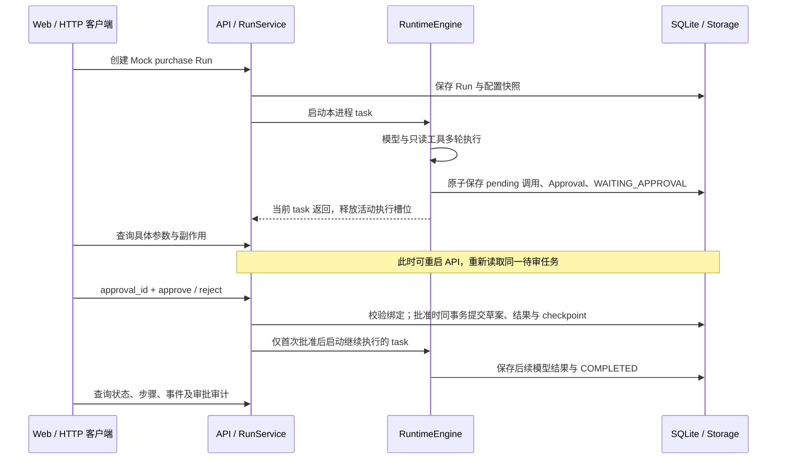

# AgentForge Day 3 学习笔记：持久化、审批中断／恢复与 Trace

> 对应 PRD 原定 10/16 的 Day 3 任务；实际交付日期为 2026-10-18。整理日期：2026-10-19（UTC+8）。
> 根据当前源码、交付记录和已保存的运行证据整理。本次只新增笔记，未重新执行 pytest、浏览器验收或外部模型调用，也未覆盖原运行证据。

阅读路线：先读第 1–2 节建立整体认识，再读第 5–8 节理解审批与恢复；第 11 节用于动手，第 12 节用于源码阅读和面试自测。
前置知识见 [Day 1](2026-10-14-day1.md)、[Day 2](2026-10-17-day2.md)；实际范围见 [Day 3 交付报告](../deliveries/2026-10-18-day3.md)和[P0 事实矩阵](../FEATURE_MATRIX.md)。Day 1/2 笔记中的“仅内存、尚无审批”等描述属于当时版本。

## 1. Day 3 要学会什么

核心目标：让一次 Agent Run 在明确的安全位置停下来，保存足够的上下文；经过人工决议后，执行绑定的那次模拟写入，再继续模型。

| Day 2 已有能力 | Day 3 增量 | 学习重点 |
|---|---|---|
| 内存 Run/Step/Event | SQLite 持久化 | 进程退出后，哪些事实仍然存在 |
| 工具权限检查 | 绑定具体调用的审批 | 授权来自后端，模型和 UI 都不能自行放行 |
| 只读工具 | 本地模拟采购草案 | 副作用必须受事务和幂等约束 |
| 进程内模型上下文 | Checkpoint 与有限恢复 | 保存数据和允许继续执行是两个判断 |
| 运行步骤列表 | 历史、审批与 Trace | 从事件、参数摘要和结果定位问题 |
| 107 项测试 | 全量 143 项 | 用数据库、并发请求和真实重启验证不变量 |

学完应能回答：

- Run、Step、Event、ToolInvocation、Approval 分别记录什么。
- 为什么“按钮不能重复点”和“先查数据库有没有”都不足以保证写入幂等。
- 一次批准绑定哪些字段，为什么不能在批准请求里改数量。
- 为什么 Run 停在 WAITING_APPROVAL 时，不需要一个 Python 协程持续等待。
- 哪些 checkpoint 可以恢复，哪些中断必须拒绝继续。
- Trace 与恢复上下文为什么不能使用同一份脱敏数据。
- 143 项通过证明了什么，哪些结论仍不能说。

## 2. 先把一次审批跑通



这是源码流程示意，不是某次执行的原始 Trace。拒绝分支记录 REJECTED，将 Run 置为 CANCELLED，不写草案，也不继续模型。

分清三个动作：**模型提出调用 → 后端保存待审请求 → 人批准后后端执行**。看到 create_purchase_draft 的请求或 pending 步骤，不表示草案已经存在。

主要入口：

```text
api.create_run → RunService.start → RuntimeEngine.run
                                  → Storage.pause
api.decide     → RunService.decide → Storage.decide
                                  → 继续 RuntimeEngine.run(resume=True)
```

## 3. 数据建模：为什么需要七张表

入口：[storage.py](../../src/agentforge/storage.py)，协议与状态类型见 [models.py](../../src/agentforge/models.py)、[runtime.py](../../src/agentforge/runtime.py)。

| 表 | 保存的事实 | 关键关联或约束 |
|---|---|---|
| agents | 可复用的 Agent 配置 | Agent ID 主键 |
| runs | 一次任务的输入、状态、计数、冻结配置、私有续传状态、revision | run_id 对应表中 id，关联 Agent |
| run_steps | 模型、工具、审批等操作的状态、时间与摘要 | (run_id, seq) 主键 |
| run_events | 已发生事件及脱敏元数据 | (run_id, event_id) 主键，应用只追加旧事件之外的新事件 |
| tool_invocations | 具体工具调用的参数、权限、执行状态、结果与审批关联 | (run_id, call_id) 主键；approval_id、idempotency_key 各自唯一 |
| approvals | 待审或已决调用、参数绑定摘要、决议时间、request_id | approval_id 主键；(run_id, call_id) 唯一 |
| purchase_drafts | 已真正创建的本地模拟草案 | approval_id、idempotency_key、(run_id, call_id) 分别唯一 |

model_resume_state 是 runs 上的 JSON 列，**不是第八张表**。Run 保存 config_snapshot，恢复时不会直接拿当前 Agent 配置替换原权限、提示词或限制。

### 3.1 几种 ID 分别回答什么问题

| 标识 | 回答的问题 |
|---|---|
| run_id | 哪一次任务？ |
| call_id | 该 Run 中哪一次工具请求？同时关联模型的调用与工具结果 |
| approval_id | 人决定的是哪一份具体待审请求？ |
| draft_id | 真正写入后得到哪一份草案？ |
| request_id | 哪一次 HTTP 请求作出了决议？轮询和重放请求有各自的 request_id |
| idempotency_key | 是否已经处理过同一个绑定调用的写入？ |

不同 Run 可以提出业务内容相同的调用。本项目的幂等键包含 run_id/call_id，不负责跨任务识别“看起来像同一笔采购”。

### 3.2 快照与事件各有什么用途

Run 快照便于直接查询当前状态；Step 描述某个操作；Event 解释“为什么走到这里”。ToolInvocation 和 Approval 提供调用与决议的独立记录。
当前通过快照和专门的恢复字段继续执行，不能仅凭“有事件表”就声称实现了完整 Event Sourcing 或能从事件重建任意历史状态。

## 4. SQLite：理解事务、唯一约束与版本

SQLAlchemy 固定为 2.0.55。API 默认数据库是仓库 data/demo.db；启动时调用 Storage.initialize，创建目录、表和 schema v1。

| 机制 | 本项目中的作用 | 边界 |
|---|---|---|
| WAL | 让读查询与短写事务更好地共存 | 不会让多个写事务同时提交 |
| foreign_keys=ON | 启用数据库外键检查 | 不替代业务参数和状态检查 |
| busy_timeout=5000 | 锁忙时最多等待约 5 秒 | 不是无限等待，也不是吞吐保证 |
| BEGIN IMMEDIATE | 写事务开始时取得写入权，再读取／判断决议 | 其他写事务需等待或失败；事务应保持短小 |
| Run revision | 拒绝陈旧内存快照覆盖较新的数据库状态 | 不等于分布式任务所有权或租约 |
| 唯一约束 | 在数据库层拒绝重复草案／绑定 | 只覆盖约束定义的键 |

本项目只支持一个 API worker。后台任务仍是 RunService 持有的 asyncio task，数据库保存事实，但没有持久化队列、跨 worker 调度或分布式锁。
同步数据库操作会占用事件循环时间；选择它是为了本机小范围实现简单、可复现，没有做生产吞吐承诺。

### 4.1 什么叫“在同一个事务里”

以下是逻辑示意，不是程序输出或可直接执行的完整 SQL：

```text
BEGIN IMMEDIATE
  读取 Approval、Run、ToolInvocation，校验当前状态与绑定
  再检查权限、严格参数、调用次数和活动时间限制
  记录审批决议及审计信息
  插入 purchase_drafts
  保存 ToolResult、模型上下文和 AFTER_APPROVED_TOOL checkpoint
  更新 Run／Step／Event
COMMIT
```

中途失败，事务回滚，不能留下“草案已写入，但审批仍未批准”的半提交状态。
`test_write_and_decision_roll_back_together` 在实际 INSERT/flush 后注入异常，再查询草案为 0、审批仍为 PENDING；恢复原方法重试后草案为 1。flush 将变更发送给数据库，**不等于 commit 已提交**。

### 4.2 初始化不等于通用迁移

当前读取 PRAGMA user_version：0 初始化到 v1；1 可重复初始化；其他版本拒绝启动并保留数据。
create_all 不承担未来任意表结构升级；没有 Alembic 或通用迁移器。以后真正改变 schema 时，需要明确迁移步骤，不能只修改 ORM 就声称旧数据库已升级。

## 5. 状态机：哪些变化合法

入口：RunState.transition。运行状态、审批状态、工具调用状态是不同实体的状态，不能混用。

| Run 当前状态 | 合法下一状态 |
|---|---|
| CREATED | RUNNING / FAILED / CANCELLED |
| RUNNING | WAITING_APPROVAL / COMPLETED / FAILED / CANCELLED / INTERRUPTED / RECONCILIATION_REQUIRED |
| WAITING_APPROVAL | RUNNING / CANCELLED / FAILED |
| INTERRUPTED | RUNNING / FAILED / CANCELLED |
| RECONCILIATION_REQUIRED | FAILED |
| COMPLETED / FAILED / CANCELLED | 无下一状态 |

状态机允许的边，不表示每条边都有公开 API。尤其 INTERRUPTED → RUNNING 还必须通过具体恢复点与数据库凭据校验；不能只看状态名称就继续。

正常采购路径：

```text
Run：CREATED → RUNNING → WAITING_APPROVAL → RUNNING → COMPLETED
审批：PENDING → APPROVED
调用：PENDING → COMPLETED
草案数：0 → 0 → 0 → 1 → 1
```

拒绝路径为 WAITING_APPROVAL → CANCELLED / APPROVAL_REJECTED，审批变 REJECTED，草案仍为 0。
WAITING_APPROVAL 是持久化等待状态，当前执行 task 已返回；重新批准后创建新的继续执行 task，不是恢复旧进程中的协程栈。

## 6. 审批：批准的是绑定调用，不是开放写权限

入口：ToolRegistry.validate、Storage.pause / _verify_pending / decide，以及 [service.py](../../src/agentforge/service.py) 的 RunService.decide。

### 6.1 为什么还需要后端政策层

Agent allowlist 中有 create_purchase_draft，仅表示可以提出该调用；工具权限仍然是 REQUIRES_APPROVAL。
普通 Registry.dispatch 始终拒绝该权限。`for_approval=True` 只用于验证／准备审批参数，不是允许任意 handler 执行的开关。

该工具没有普通 handler，真正的写入由 Storage._insert_draft 在审批事务中完成。这是一条刻意限定的内置本地写路径，没有扩展成任意外部工具的事务执行器。

### 6.2 具体绑定哪些内容

下面是采购 Demo 的参数示例，不是新的执行记录：

```json
{
  "supplier": "B",
  "quantity": 20,
  "unit_price_cents": 98000,
  "budget_cents": 2000000
}
```

金额单位为分：98000 分是 980 元，20 台合计 1960000 分，即 19600 元。参数模型还检查供应商、当前 fixture 单价和预算限制，不能让模型自行压低单价来绕过预算。

绑定摘要根据下面的整体对象生成：

```text
SHA-256(规范序列化后的 {run_id, call_id, tool_name, arguments})
```

JSON 使用固定键排序和分隔符；摘要用于比较绑定是否一致。它不是数字签名，不能防住有权限同时改数据库内容和摘要的人，也不承担身份认证。

HTTP 请求只提交：

```json
{"approval_id":"<待审 ID>","decision":"approve"}
```

decision 也可以是 reject。不能附加 quantity 或 arguments 来替换原参数；额外字段返回 422。跨 Run 使用审批 ID 也会被拒绝。
后端从数据库取原参数，再校验冻结 allowlist、当前参数模型和调用绑定；如果 fixture 单价已经变化，可能拒绝执行，不能悄悄用新价格替换已审参数。

## 7. 幂等与并发：为什么重复批准只写一份

“禁用按钮”能减少误点，但客户端可重试、网络响应可丢失，还可能有多个并发请求。真正的约束必须在后端和数据库。

| 情况 | 后端行为 | 对同一绑定调用的草案数量 |
|---|---|---:|
| 第一次 approve，事务成功 | 记录 APPROVED，写草案，继续模型 | 1 |
| 再次 approve | 返回 replayed=true，不重新写入或调度 | 1 |
| 多个 approve 并发 | 短写事务串行取得决议；后续请求读取已决状态 | 1 |
| approve 后又 reject | 409 / APPROVAL_CONFLICT | 1 |
| reject 后又 reject | 同决议重放，无写入 | 0 |
| reject 后又 approve | 409 / APPROVAL_CONFLICT | 0 |

不能把“先 SELECT 没有，再 INSERT”单独当成并发保证：如果没有适当事务，多个请求可能都读到不存在。
本例通过 BEGIN IMMEDIATE、事务内重新判断决议，以及草案上的三个唯一约束共同保护。普通重复决议不新增第二条实际审批事件，原始决议的 request_id 可追溯。

两个容易忽略的实现细节：

- Runtime 暂停时已经原子保存 WAITING_APPROVAL，finally 不再保存旧快照，避免与批准发生竞争；revision 也会拒绝陈旧保存。
- 旧 task 的完成回调只删除自己对应的任务引用，防止误删后来启动的恢复 task。

本地草案、审批和 checkpoint 都在一个 SQLite 事务内，才有这里的原子边界。若写入发生在真实 ERP，远端可能成功、本地却未记下结果；这个 Demo 无法保证这种外部副作用 exactly-once，也不会盲目重发未知写入。

## 8. Checkpoint／Resume：保存哪些内容，允许从哪里继续

### 8.1 Checkpoint 保存的是继续执行所需状态

| 字段 | 用途 |
|---|---|
| config_snapshot | 冻结提示词、工具权限、模型配置和限制 |
| model_resume_state.context | 原任务、模型返回、工具结果及必要续传协议项 |
| pending_calls | 已被模型提出、尚需处理的调用队列 |
| adapter | Mock 原脚本／repeat_last，或 Live 的模型描述 |
| safe_point | 明确标记当前处于哪个执行边界 |
| checkpoint_digest | 校验配置与续传状态的一致性 |
| ToolInvocation / Approval / 草案凭据 | 证明调用绑定、决议与本地写结果相符 |

保存 Mock 原脚本，是为了重启后不根据可能变化的 fixture 重新生成另一段执行过程。pending_calls 则让恢复继续处理已知调用，不必再向模型索要一次相同决定。

Responses 的上下文仍需保留 function_call、call_id、function_call_output，以及必要的不透明 reasoning encrypted_content；不保存隐藏推理原文。恢复 Live 要求环境仍配置同一模型和可用 Key，不能把 SDK 离线续传测试当成外部 Live 验证。

### 8.2 当前恢复矩阵

| 重启前状态／边界 | 启动后的行为 | 能否继续 |
|---|---|---|
| WAITING_APPROVAL，绑定和 checkpoint 有效 | 保留原 Run／审批／上下文，追加恢复事件 | 正常 approve/reject |
| WAITING_APPROVAL，但校验不通过 | FAILED / CHECKPOINT_INVALID | 不能执行该待审写入 |
| RUNNING + AFTER_APPROVED_TOOL | 先记为 INTERRUPTED | 显式 resume，验证草案凭据和上下文后才继续 |
| 模型或只读工具调用进行中 | INTERRUPTED | 当前不支持恢复 |
| AFTER_READ_TOOL | 结果虽已保存，仍未开放这个恢复点 | 当前不支持恢复 |
| RUNNING 且敏感调用执行结果未知 | RECONCILIATION_REQUIRED / WRITE_OUTCOME_UNKNOWN | 不补发；需人工核对，尚无核对控制 API |
| CREATED，任务还没开始 | FAILED / PROCESS_NOT_STARTED | 可新建 Run |
| COMPLETED / FAILED / CANCELLED | 保持原终态 | 不能恢复到 RUNNING |

**WAITING_APPROVAL 用 approve，不用 resume。** resume 只用于当前支持的已批准中断点；普通重复批准不会重新驱动已中断的后续执行。

启动时的 Storage.recover 负责分类，Storage.claim_resume 负责显式领取可恢复断点；后者还要核对已批准审批、已完成写调用、真实草案、工具结果及上下文。数据库有记录，只是恢复判断的一部分。

正常关闭服务会取消仍活动的 task，它们可能已经持久化为 CANCELLED；这类终态不能再恢复。等待审批 task 已返回，因此正常关闭后仍可保留等待状态。不要将“服务重启”理解成所有 RUNNING 都会自动接着跑。

## 9. Trace 与 API：观察执行，同时保留私有恢复上下文

入口：[api.py](../../src/agentforge/api.py)、[redaction.py](../../src/agentforge/redaction.py)、[Workbench](../../apps/web/src/main.tsx)。

### 9.1 页面上的不同数字怎么读

保存的采购运行中，待审批时为 4 次模型、7 次已执行工具，但有 8 条 ToolInvocation，因为第 8 条写调用仍 pending。
批准完成后为 5 次模型、8 次工具，14 条 Step：5 个模型步骤、8 个工具步骤、1 个审批步骤。step_count 是决策轮次，不等于 Step.seq 或总步骤数。
具体计数来自 [database-assertions.json](../evidence/day3/database-assertions.json)，不是用静态页面模拟的执行记录。

| 观察项 | 含义 |
|---|---|
| Run status / stop_reason | 当前运行状态，以及暂停或终止原因 |
| Step status / duration_ms | 单个操作的状态及实测耗时；pending 调用还没有执行耗时 |
| arguments_summary / result_summary | 用于定位问题的工具参数／结果脱敏摘要 |
| event_id / step_id / timestamp | Run 内的事件顺序、关联操作及时间 |
| active_seconds | 活动执行时间，人工审批等待单独统计 |
| approval_wait_seconds | 决议时累计的审批等待时间；等待期间可能仍显示 0 |
| cost / token_accounting | 缺价格时成本为 unknown；字节估计不是真实 token 账单 |

Checkpoint 通过 run.checkpointed、run.checkpoint_restored、run.resumed 等事件追踪；并不要求每个 checkpoint 都单独占一条 Step。

UI 在 CREATED/RUNNING/WAITING_APPROVAL 时轮询 Run、steps、events 和审批列表，当前采用约 400ms 的查询调度间隔；网络请求和渲染使实际刷新间隔并非严格固定。没有 SSE，也不能将该间隔当作平台延迟指标。

### 9.2 Trace 为什么不能直接用来恢复

公开 Trace 是经过裁剪和脱敏的观察数据，不能拿缺失字段的摘要合法重放模型协议。

- RunView 明确过滤私有 config_snapshot 和 model_resume_state。
- Trace 参数／结果只放行已知 Demo 字段，未知字段和已知秘密模式遮盖；事件入库前也脱敏。
- 私有 SQLite 仍保留恢复需要的精确 Demo 输入、参数与续传上下文，API Key 不进配置快照。
- 已知规则脱敏不等于通用 DLP，数据库也不是加密保险箱；只使用合成 Demo 数据。

截图见[待审批](../evidence/day3/waiting-approval.png)、[批准后的参数／结果与事件](../evidence/day3/approved-trace.png)、[预算失败](../evidence/day3/failure-trace.png)。

### 9.3 审批与恢复使用公开 HTTP 契约

| 方法／路径 | 用途 |
|---|---|
| GET /api/approvals | 只返回当前可操作的 pending 审批 |
| GET /api/runs/{run_id}/approvals | 查询该 Run 的待审及已决记录 |
| POST /api/runs/{run_id}/approve | approve/reject，首次或同决议重放返回 200 |
| POST /api/runs/{run_id}/resume | 领取验证通过的恢复点，返回 202 |
| GET /api/runs/{run_id}/steps、/events | 查询持久化操作与事件；事件支持 after_event_id 游标 |

批准返回 200 不表示后续模型已完成，恢复返回 202 也要继续查询状态。参数不合法为 422；决议冲突或不安全恢复点为 409；Live 配置缺失或存储忙可为 503。以 [API_CONTRACT](../API_CONTRACT.md)和[实际 OpenAPI 快照](../evidence/day3/openapi.json)为准。
UI、curl、Java/TypeScript/Go HTTP 客户端使用同一契约；Python 是服务端实现语言，不是平台客户端的使用前提，也没有因此开发出其他语言 Runtime。

## 10. 测试证据：区分真实重启、并发和故障注入

### 10.1 143 项是什么

Day 3 开始先跑原 107 项基线；新增 36 项：持久化 30、审批 API 4、真实 API 进程重启 1、SQLite 下 Responses 续传 1。参数化状态迁移实例各计一项，不能把基线与全量相加成 250 项不同测试。

整理时现存 [pytest.txt](../evidence/day3/pytest.txt) 中的原始末行是：

```text
143 passed in 39.41s
```

这是已保存的一次运行结果，**不是本次笔记整理重新执行的结果**。交付报告可能记录另一次运行的耗时；重复执行后 UUID、时间戳和耗时会变化。39.41s 不是模型延迟、平台 p95 或性能承诺。
完整名称见 [test-names.txt](../evidence/day3/test-names.txt)，机器结果见 [pytest.xml](../evidence/day3/pytest.xml)，历史摘要见 [RESULTS](../RESULTS.md)。

### 10.2 用哪些测试证明不变量

以下名称位于 [test_persistence.py](../../tests/test_persistence.py)，除最后两行注明其他文件：

| 测试名称 | 检查的事实 |
|---|---|
| test_unapproved_write_is_persisted_pending_with_zero_drafts | pending 调用、上下文、审批已保存，草案 0 |
| test_rejection_never_creates_draft | 拒绝后 CANCELLED、REJECTED、草案 0 |
| test_sequential_and_concurrent_approve_create_only_one_draft | 12 次线程并发，只有一次首次决议，草案 1；顺序重试仍 1 |
| test_write_and_decision_roll_back_together | INSERT 后提交前异常，决议和草案一起回滚 |
| test_pending_parameter_tampering_never_writes | 修改已保存待审参数后校验失败，草案 0 |
| test_unknown_write_outcome_requires_reconciliation_without_replay | 构造未知写状态，恢复进入待核对并拒绝补发 |
| test_confirmed_local_write_checkpoint_can_resume_without_repeating_write | 已批准安全点校验通过后继续，草案仍 1 |
| test_terminal_run_is_never_resumed | 终态不可继续 |
| test_api_rejects_bound_parameter_override_and_cross_run_approval（test_approval_api.py） | HTTP 不能覆盖参数或挪用其他 Run 的审批 |
| test_real_process_restart_restores_same_approval_context_and_one_draft（test_recovery_process.py） | 真 Uvicorn 停启、相同上下文、真实并发 HTTP 批准、SQL 断言 |

### 10.3 三种证据不能混为一谈

| 验证方式 | 实际做了什么 | 不能外推为什么 |
|---|---|---|
| 真实进程重启测试 | 在 WAITING_APPROVAL 终止／重启 Uvicorn；核对原 ID／参数／上下文；12 个 HTTP 请求竞争首次批准 | 任意指令位置强杀都能恢复 |
| 故障状态／异常注入 | 构造未知写或已提交安全点；调用启动恢复检查；在 INSERT 后抛异常验证回滚 | 已实测任意外部系统的崩溃一致性 |
| 浏览器统一验收 | 真实等待／重启／批准／拒绝／预算失败，SQL 核对；另做批准后的 12 次并发重放 | 浏览器测试覆盖全部 UI 或生产安全 |

特别区分：pytest 重启测试中的 12 请求竞争的是**首次批准**；统一浏览器脚本中的 12 请求是**已经批准后的重放**，两者验证不同阶段。
Responses SQLite 续传测试使用明确合成的 HTTP fixture，经真实 SDK 解析，不代表外部 Live 成功。MCP 真实客户端／服务端回归仍包含在全量测试里。

### 10.4 实际失败给出的经验

| 已发生问题 | 学习点与修复 |
|---|---|
| 损坏待审 checkpoint 使启动报错 | 对该 Run 失败关闭并记录 CHECKPOINT_INVALID，避免单个坏任务拖垮整个服务启动 |
| 手机号正则误伤 SHA-256 数字段 | 脱敏规则也需要精确测试，加入边界后保留正常摘要 |
| 5173 被已有开发服务占用 | 验证器分配临时端口，不停止用户现有服务 |
| Windows 重启同端口的预探测 bind 遇到 TIME_WAIT | 由 Uvicorn 实际绑定，不用测试预探测错误拦截重启 |

原始失败见 [initial-persistence-failure.txt](../evidence/day3/initial-persistence-failure.txt)、[checkpoint-redaction-failure.txt](../evidence/day3/checkpoint-redaction-failure.txt)；更多边界见 [FAILURE_MODES](../FAILURE_MODES.md)。

## 11. 动手实验：从页面一直查到数据库

下面是供学习时执行的命令，本次整理没有运行这些演示或测试。除首次依赖／浏览器安装外，Mock 验证只访问本机；依赖安装步骤见 [README](../../README.md)。

### 实验 A：运行自动化完整验收

在仓库根目录：

```powershell
.\.venv\Scripts\python.exe scripts/verify_day3.py
```

脚本使用临时数据库、临时端口和真实浏览器，清理自己启动的进程；Windows 优先用已安装 Edge，其他环境需先安装 Playwright Chromium。
它会重新生成 docs/evidence/day3 下的当前验收输出，UUID 和耗时会变化，不要将旧报告中的某个 ID 当成固定业务值。

### 实验 B：手动观察等待、重启和批准

两个终端分别执行；只重启自己启动的 API，API 重启前后使用同一数据库文件：

```powershell
# 终端 1：使用独立学习数据库，不设置任何真实模型 Key
$env:AGENTFORGE_DB_PATH = "data/day3-learning.db"
.\.venv\Scripts\python.exe -m uvicorn agentforge.api:app --host 127.0.0.1 --port 8000
```

```powershell
# 终端 2：前端
npm.cmd --prefix apps/web run dev
```

1. 打开 http://127.0.0.1:5173，选择 purchase-demo、Mock、采购草案待审批场景。
2. 输入“比较合成供应商报价，拟定 20 台采购草案，等待我批准后再创建”，启动。
3. 记下 run_id、approval_id、具体参数和参数摘要；观察 WAITING_APPROVAL，草案尚未写入。
4. 在终端 1 停止自己启动的 API，再执行同一启动命令；刷新页面，核对原审批仍在。
5. 批准，观察 COMPLETED、5 次模型／8 次工具，以及 write 的参数／结果摘要和审批事件。
6. 新建另一个 Run，改点拒绝，观察 CANCELLED / APPROVAL_REJECTED。不能在已经批准的同一审批上用 reject 代替这个实验，那会得到冲突。

Mock 工具选择由固定脚本决定，任务文字不改变脚本行为；这条实验验证控制流，不证明模型理解了采购要求。

在数据库查看器中，对当前学习数据库执行下面的只读 SQL；替换真实 run_id 后，观察等待时 0、批准后 1、拒绝的新 Run 为 0：

```sql
SELECT COUNT(*) AS draft_count
FROM purchase_drafts
WHERE run_id = '<待核对的 run_id>';

SELECT approval_id, run_id, call_id, status, args_digest
FROM approvals
WHERE run_id = '<待核对的 run_id>';
```

截图可帮助观察，SQL 断言才直接验证写入数量。不要修改生产数据或手工删除表来“重置”实验。

### 实验 C：用 curl 提交、批准和重复批准

已有 API 服务时，在根目录 PowerShell 执行，不需要 Python 客户端 SDK：

```powershell
$created = curl.exe --silent --show-error --fail --noproxy "*" -H "Content-Type: application/json" --data-binary "@examples/http/approval-run.json" http://127.0.0.1:8000/api/runs | ConvertFrom-Json
$runId = $created.data.run_id
curl.exe --silent --noproxy "*" "http://127.0.0.1:8000/api/runs/$runId"
# 查询状态为 WAITING_APPROVAL 后再执行下面步骤
$pending = curl.exe --silent --noproxy "*" "http://127.0.0.1:8000/api/runs/$runId/approvals" | ConvertFrom-Json
@{approval_id=$pending.data[0].approval_id; decision="approve"} | ConvertTo-Json -Compress | Set-Content -Encoding ascii approval-request.json
curl.exe --silent --show-error --fail --noproxy "*" -H "Content-Type: application/json" --data-binary "@approval-request.json" "http://127.0.0.1:8000/api/runs/$runId/approve"
# 重复同一决议，预期 replayed=true；数据库草案仍只有 1
curl.exe --silent --show-error --fail --noproxy "*" -H "Content-Type: application/json" --data-binary "@approval-request.json" "http://127.0.0.1:8000/api/runs/$runId/approve"
curl.exe --silent --noproxy "*" "http://127.0.0.1:8000/api/runs/$runId/events"
```

思考：第二次批准返回 200 时，为什么不能理解成“又执行了一次工具”？如果后续模型失败但草案已提交，为什么 Run 失败也不代表草案被撤回？结合事务边界与 ToolInvocation.result 找答案。

### 实验 D：单独运行关键失败模式

```powershell
.\.venv\Scripts\python.exe -m pytest tests/test_persistence.py -q
.\.venv\Scripts\python.exe -m pytest tests/test_approval_api.py -q
.\.venv\Scripts\python.exe -m pytest tests/test_recovery_process.py -q
.\.venv\Scripts\python.exe -m pytest tests/test_persistence.py::test_write_and_decision_roll_back_together -q
.\.venv\Scripts\python.exe -m pytest tests/test_persistence.py::test_unknown_write_outcome_requires_reconciliation_without_replay -q
```

先读断言，再运行：找出 SQL COUNT、Run 状态、审批状态和事件的核对点。测试只断言 HTTP 200，无法证明这些不变量。

## 12. 源码阅读顺序与五个面试自测

### 12.1 按执行路径读源码

| 顺序 | 源码入口 | 读完后画出什么 |
|---|---|---|
| 1 | runtime.py：RunState.transition、RuntimeEngine.run | 合法状态、何时 persist、写调用何时暂停 |
| 2 | tools.py：schemas / validate / dispatch；demo.py：PurchaseDraftArgs | 提出敏感调用与真正执行之间的权限边界 |
| 3 | storage.py：ORM、transaction、_save、pause | 一个等待点需要哪些表／字段、revision 如何保护保存 |
| 4 | storage.py：_verify_pending、decide、_insert_draft | 参数绑定、同库事务和幂等路径 |
| 5 | storage.py：recover、claim_resume；service.py：restore_adapter | 恢复矩阵、凭据检查和适配器重建 |
| 6 | service.py：_schedule / decide / close | task 归属、继续执行与资源清理 |
| 7 | api.py、redaction.py、apps/web/src/main.tsx | 公开字段、事件脱敏、审批和轮询 |
| 8 | tests/test_persistence.py、test_approval_api.py、test_recovery_process.py | 用反例检查自己的架构理解 |

### 12.2 五个追问与参考答案

1. **为什么不让模型输出 approved=true 就执行？** 模型和工具内容不具备授权能力。后端读取独立审批决议，验证绑定调用和冻结 allowlist；普通 Registry dispatch 永远不放行敏感权限。prompt、工具 Schema 和按钮禁用都不能替代这个检查。
2. **两个请求同时 approve，凭什么只有一份草案？** 短写事务先取得写入权并重新读决议，首次成功后其余是重放；数据库对 approval_id、idempotency_key、(run_id,call_id) 有唯一约束。事务把决议、草案、结果和安全 checkpoint 一起提交。线程与真实 HTTP 并发测试都检查草案为 1。
3. **“能重启恢复”究竟恢复什么？** WAITING_APPROVAL 保留原 ID／任务／参数，批准后继续；已提交草案的安全点需核对凭据才能 resume。不能恢复 Python 调用栈或任意模型／工具 I/O 中间状态，终态不复活，未知写结果转待核对。
4. **为什么不用队列或生产数据库？** 本机单用户目标下，SQLite 加明确事务和状态边界足够演示。task 仍属于单进程，WAL 不是分布式协调，同步 DB 也有阻塞代价。多节点调度和真实外部副作用需要另行设计，本周没有实现这些能力。
5. **公开 Trace 脱敏后，模型如何接着执行？** 恢复使用私有精确上下文，Trace 使用独立的脱敏摘要。必要的 provider 协议项不能丢，但隐藏推理原文不保存；Key 不进快照。私有 DB 仍含 Demo 输入，不声称全库无原文或通用 DLP。外部 Live 仍未测。

## 13. 当前可以与不可以声称的成果

| 可以准确表达 | 不能据此声称 |
|---|---|
| 自研 Runtime 实现持久化审批和明确安全点恢复 | 任意位置无损恢复、任意工具 exactly-once |
| 本地模拟草案经事务及唯一约束实现绑定调用幂等 | 真实 ERP／采购订单的一致性已解决 |
| 真实进程重启、数据库断言、并发批准与浏览器验收已保存证据 | 生产规模、HA 或 SLA 已验证 |
| 143 项程序回归通过，Mock 确定性路径可重复 | 真实模型准确率、Live 成功率或虚构成本收益 |
| HTTP/OpenAPI 供不同技术栈客户端调用 | Java/Go 原生 Runtime 或官方客户端 SDK 已交付 |

整个 PRD 的 P0 仍为部分完成：独立 JSONL Evals／两批比较、Docker Compose／CI 尚待交付；SSE 为 P1，当前轮询满足 Day 3 要求。Live 路径有实现，外部 API 未测。
Codex 负责代码实现；候选人参与需求、技术取舍、审阅、验收与面试讲解，个人贡献应按实际参与说明。本次新增学习文档，没有新增／修改 OpenAPI 端点，也没有重新产生测试或模型质量成果。

继续查阅：[设计决策 D012–D015](../DECISIONS.md)、[架构](../ARCHITECTURE.md)、[接口契约](../API_CONTRACT.md)、[失败案例](../FAILURE_MODES.md)、[实际结果](../RESULTS.md)、[面试笔记](../INTERVIEW_NOTES.md)。
